# <a id="chapter-3"></a><a id="ch:DVBS2Arch&Conc"></a>3 DVB-S2 MODEM Concepts and Architecture

## <a id="section-3.1"></a>3.1 Modulation and Coding Schemes

The coding/modulation (C/M) problem consists of finding practical ways of communicating discrete messages reliably on a realistic channel: this may involve space and satellite communications, data transmission over twisted-pair telephone wires, shielded cable-TV wire, data storage, digital audio/video transmission, mobile communication, terrestrial radio, deep-space radio, indoor radio, or file transfer. The channel causes transmission quality degradation, as it includes attenuation, thermal noise, intersymbol interference, multiple-user interference, multipath propagation, and power limitations. The most general statement about the selection of a C/M scheme is that it should make the best possible use of the resources available for transmission, bandwidth, power, and complexity, in order to achieve a required Quality of Service (QoS), i.e., the specified minimum performance requirement imposed on the service. Typically, the latter is expressed in terms of error probability, which is a decreasing function of the signal-to-noise ratio (SNR). Sensible strategies for C/M design must define a trade-off among four factors:

- The requirement on error probability, which tells us how reliable the transmission is.

- The available bandwidth (or spectral) efficiency, which measures the efficiency in bandwidth expenditure.

- The signal-to-noise ratio (SNR) necessary to achieve the required QoS. This gives us a measure of how efficiently the C/M scheme makes use of the available power.

- Implementation complexity, which is a measure of the cost of the equipment.

### <a id="section-3.1.1"></a>3.1.1 BICM: How to Obtain Top Performance Using a Single Code and Various Modulations

Forward Error Correction codes for satellite applications must combine power efficiency and low BER floor with flexibility and simplicity to allow for high-speed implementation. The existence of practical, simple, and powerful such coding designs for binary modulations has been settled with the advent of turbo codes (Claude Berrou, Alain Glavieux, Punya Thitimajshima 1993) and the recent re-discovery of Low-Density Parity-Check (LDPC) codes (Robert Gallagher 1963). In parallel, the field of channel coding for non-binary modulations has evolved significantly in recent years. Starting with Ungerboeck’s work on Trellis-Coded Modulation (TCM) (Gottfried Ungerboek 1981), the approach had been to consider channel code and modulation as a single entity, to be jointly designed and demodulated/decoded.

Schemes have been published in the literature, where turbo codes are successfully merged with TCM (P.Robertson and T.Worz 1998). Nevertheless, the elegance and simplicity of Ungerboeck’s original approach gets somewhat lost in a series of ad-hoc adaptations; in addition, the turbo-code should be jointly designed with a given modulation, a solution impractical for systems supporting several constellations. A new pragmatic paradigm has crystallized under the name of Bit-Interleaved Coded Modulation (BICM) (G.Caire, G.Taricco, E.Biglieri 1997), where extremely good results are obtained with a standard non-optimized code. An additional advantage of BICM is its inherent flexibility, as a single mother code can be used for several modulations, an appealing feature for broadband satellite communication systems where a large set of spectral efficiencies is needed.

### <a id="section-3.1.2"></a>3.1.2 Choice of Modulation Scheme

Some key issues, such as the usage of increasingly high frequency bands (e.g., from X, Ku, up to Ka and Q) and large deployable spacecraft antennas providing high gain, together with availability of high on-board power attainable by large platforms currently the subject of study, have moved the focus from good-old modulation schemes, such as QPSK, to higher order modulation schemes, better suited to providing the high data rate required by up-to-date applications such as internet via satellite, or DVB DNSG (Digital Satellite News Gathering).

Digital transmissions via satellite are affected by power and bandwidth limitations. Satellites, in fact, were born power limited and this limitation is still the major constraint in satellite communications. Therefore, DVB-S2 provides for many transmission modes (FEC coding and modulations), giving different trade-offs between power and spectrum efficiency. Code rates of 1/4, 1/3, 2/5, 1/2, 3/5, 2/3, 3/4, 4/5, 5/6, 8/9 and 9/10 are available depending on the selected modulation and the system requirements. Coding rates 1/4, 1/3 and 2/5 have been introduced to operate, in combination with QPSK, under exceptionally poor link conditions, where the signal level is below the noise level. Computer simulations demonstrated the superiority of such modes over BPSK modulation combined with code rates 1/2, 2/3 and 4/5. The introduction of two FEC code block lengths (64800 and 16200) was dictated by two opposite needs: the C/N performance improves for long block lengths, but the end-to-end modem latency increases as well. Therefore, for applications not critical with respect to delay (such as broadcasting) the long frames are the best solution, while for interactive applications a shorter frame may be more efficient when a short information packet has to be forwarded immediately by the transmitting station. Four modulation modes can be selected for the transmitted payload. Modulation formats provided by DVB-S2:

QPSK and 8-PSK  
which are typically employed in broadcast applications since they have a constant envelope and therefore can be used in nonlinear satellite transponders near the saturation operating regime;

16-APSK and 32-APSK  
schemes can also be used for broadcasting, but these require a higher level of available $`C/N`$ ratio and, furthermore, the adoption of pre-distortion techniques.

<a id="figure-3.1"></a><a id="fig:Q8PSK"></a>

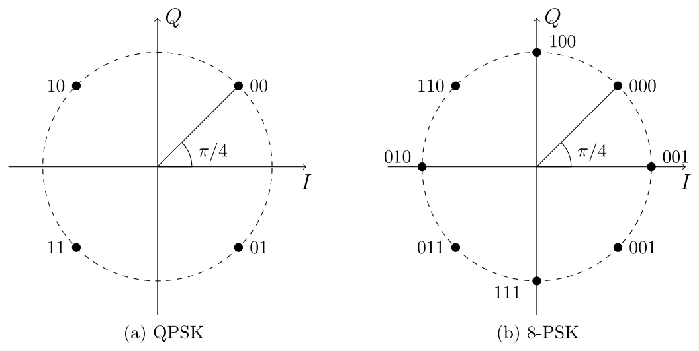

***Figure 3.1:** QPSK and 8-PSK DVB-S2 constellations with normalized radius $`\rho=1`$*

<a id="figure-3.2"></a><a id="dd"></a>

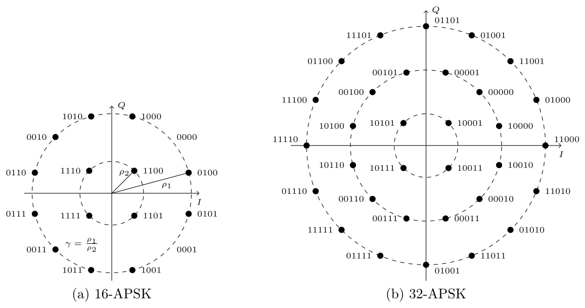

***Figure 3.2:** APSK constellations with normalized mean energy*

### <a id="section-3.1.3"></a>3.1.3 The Ultimate Bound to Compare Modem Performance

As said by Shannon in 1948, year of publication of his paper (Claude E.Shannon 1948), “the fundamental problem of communication is that of reproducing either exactly or approximately a message selected at another point”. Shannon in his work set up the basis of Information Theory. As also pointed out by Hartley, he defined the logarithmic measure of information as the most natural choice, relating reliable transmission to statistical characterizations of channels.

From an engineering point of view, one of the most important points raised by Shannon’s work is the relationship between the mean power available at the transmitters and the communication reliability. One of the most important aims in satellite applications is often finding the best trade-offs between the above quantities. This is mainly due to limited power resources on-board which have to be exploited in the most efficient way. For example, waste of power would decrease not only the mean lifetime of the satellite, but also the communication throughput.

By using Shannon’s theorem on channel capacity, an important limit on communications performance is achievable. From his theorem in (Claude E.Shannon 1948), the capacity of a discrete-time additive white Gaussian noise (AWGN) channel is given by <a id="eq-3.1"></a><a id="eq:Capbpt"></a>
``` math
\begin{equation}
C = \frac{1}{2} \log_2( 1 + \frac{S}{N})\,\mathrm{bits/transmission}
 \tag{3.1}
\end{equation}
```
When dealing with a continuous-time, bandlimited, additive white Gaussian noise channel with noise power spectral density $`\frac{N_{\mathrm{0}}}{2}`$, input power constraint $`P`$, and bandwidth $`W`$, one can sample at the Nyquist rate[^3] and obtain a discrete time channel. The power per sample will be $`P`$ and the noise power per sample will be $`WN_{\mathrm{0}}`$. Substituting these results in [(3.1)](#eq:Capbpt), we obtain <a id="eq-3.2"></a>
``` math
\begin{equation}
C = \frac{1}{2}\log_2\left(1+\frac{P}{N_{\mathrm{0}}W}\right) \,\mathrm{bits/transmission}
 \tag{3.2}
\end{equation}
```
If we multiply this result by the number of transmissions per second, which is $`2W`$, we obtain the channel capacity in bps <a id="eq-3.3"></a>
``` math
\begin{equation}
C = W \log_2\left(1+\frac{P}{N_{\mathrm{0}}W}\right) \,\mathrm{bps}
 \tag{3.3}
\end{equation}
```
From this result, the basic factors that determine the channel capacity are the channel bandwidth $`W`$, the noise power spectrum $`N_{\mathrm{0}}`$, and the signal power $`P`$. There exists a tradeoff between $`P`$ and $`W`$ in the sense that one can compensate for the other.

Increasing the input signal power obviously increases the channel capacity, because when one has more power to spend, one can choose a larger number of input levels that are far apart, and therefore more information bits per transmission are possible. However, the increase in capacity as a function of power is logarithmic and slow. This is because if one is transmitting with a certain level of immunity against noise and wants to increase the number of input levels, one has to introduce new levels with amplitudes higher than the existing levels, and this requires a lot of power. This fact notwithstanding, the capacity of the channel can be increased to any value by increasing the input power.

The effect of the channel bandwidth, however, is quite different. Increasing $`W`$ has two contrasting effects. On one hand, on a higher bandwidth channel one can transmit more samples per second and therefore increase the transmission rate. On the other hand, a higher bandwidth means higher input noise to the receiver and this degrades its performance. Letting the bandwidth $`W`$ tend to infinity, one can observe that, contrary to the power case, capacity cannot be increased to any desired value by increasing the bandwidth alone.

In any practical communication system we must have $`R < C`$. If an AWGN channel is employed, we have <a id="eq-3.4"></a>
``` math
\begin{equation}
R < W \log_2 \left( 1+\frac{P}{N_{\mathrm{0}}W}\right)
 \tag{3.4}
\end{equation}
```
By dividing both sides by $`W`$ and defining $`\eta=\frac{R}{W}`$, the spectral efficiency measured in $`\frac{\,\mathrm{bit}}{\,\mathrm{Hz}}`$, we obtain <a id="eq-3.5"></a>
``` math
\begin{equation}
\eta < \log_2\left(1+\frac{P}{N_{\mathrm{0}}W} \right)
 \tag{3.5}
\end{equation}
```
If $`E_{\mathrm{b}}`$ is the energy per bit, then $`E_{\mathrm{b}}=\frac{P}{R}`$. By substituting in the previous relation, we obtain[^4] <a id="eq-3.6"></a>
``` math
\begin{equation}
\eta < \log_2\left(1+\eta\frac{E_{\mathrm{b}}}{N_{\mathrm{0}}} \right)
 \tag{3.6}
\end{equation}
```
This relation is plotted in Figure [3.3](#f:ShBou). The curve defined by <a id="eq-3.7"></a>
``` math
\begin{equation}
\frac{E_{\mathrm{b}}}{N _{\mathrm{0}}} = \log_{10}\left(\frac{2^{\eta}-1}{\eta} \right)
 \tag{3.7}
\end{equation}
```
divides the plane in two regions. In one region (above the curve) reliable communication is possible, and in the other region (below the curve) reliable communication is not possible. The performance of any communication system can be denoted by a point in this plane and the closer the point is to this curve, the closer is the performance of the system to an optimal system. From this curve it is seen that <a id="eq-3.8"></a>
``` math
\begin{equation}
\frac{E_{\mathrm{b}}}{N_{\mathrm{0}}}=\ln 2= 0,693\sim -1,592 \,\mathrm{dB}
 \tag{3.8}
\end{equation}
```
is an absolute minimum for reliable communication. In other words, for reliable communications, we must have <a id="eq-3.9"></a>
``` math
\begin{equation}
\frac{E_{\mathrm{b}}}{N_{\mathrm{0}}}>0,693
 \tag{3.9}
\end{equation}
```
In Figure [3.3](#f:ShBou), when $`\eta \ll 1`$, we are dealing with a case where bandwidth is large and the main concern is limitation on power. This case is usually referred to as the *power limited case*. Signaling schemes with high dimensionality, such as orthogonal, biorthogonal, and simplex, are frequently used in these cases. The case where $`\eta \gg 1`$ happens when the bandwidth of the channel is small, and therefore is referred to as the *bandwidth limited case*. Low-dimensional signaling schemes with crowded constellations are implemented in this case.

Plotting on the spectral efficiency–average power plane performance of several modulation schemes, we could observe that the SNR penalty (with respect to the Shannon limit) decreases as the modulation order increases $`M`$. In other words, at the expense of a higher complexity, performance very close to the Shannon limit can be achieved. However, in this manner, the system would operate at spectral efficiencies excessively small or large if compared to those commonly required.

<a id="figure-3.3"></a><a id="f:ShBou"></a>

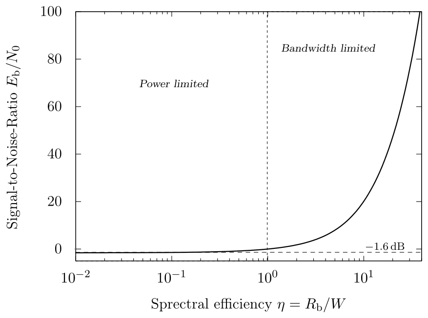

***Figure 3.3:** Shannon Bound: On the horizontal axis is reported spectral efficiency $`\eta`$, on the vertical axis Signal-to-Noise Ratio measured in $`\,\mathrm{dB}`$; Dotted line at $`-1.6 \,\mathrm{dB}`$ represents the asymptotic value for $`\eta \simeq 0`$; Heavy line is the Shannon curve above which every point must stay*

As we shall see in detail in Section [3.4](#sec:Perf), Figure [3.14](#f:Perf) shows performance for each modulation and coding (C/M) scheme adopted by the DVB-S2 modulator with respect to the calculated Shannon limit. Thanks to an optimized choice of C/M schemes, the DVB-S2 modulator provides a wide range of spectral efficiencies (see Table [3.7](#tb:EtaPerf)) while ensuring performance very close to the Shannon limit.

### <a id="section-3.1.4"></a>3.1.4 Adaptive Coding Modulation

The Adaptive Coding Modulation (ACM) technique allows different modulation formats and error protection levels (i.e., coding rates) to be used and changed on a frame-by-frame basis within the transmitted data stream. By means of a return channel, informing the transmitter of the actual receiving condition, the transmission parameters may be optimized for each individual user, dependent on link conditions. Today, ACM is considered as a powerful tool to further increase system capacity, allowing for better utilization of transponder resources.

Since it is well known that the higher the frequency bands used, the less the link performance tends to remain location-independent and stationary (i.e., stable space-wise), countermeasures to counteract the above link variations are required. One can adopt static or dynamic solutions: adopting static countermeasures against propagation effects simply means to dimension link parameters (e.g. antenna diameter, power) on a worst-case basis (link budgets usually contain an item called ‘propagation margin at nn % of time’); on the other hand, the most common form of dynamic countermeasure is power control, a technique to manage both propagation phenomena. Despite the beneficial power control effect on system efficiency, when for instance a user up-link operates in clear weather or in light traffic conditions, the potentiality of that link is not fully exploited. In other words, power control helps, but does not solve the problem of system parameters over-sizing.

Current point-to-point multi-beam satellite systems based on the DVB-S standard are designed for link closure in the worst-case propagation and location conditions. The old DVB-S standard, envisaged for broadcasting applications, considers a fixed coding rate and modulation format, which are selected according to the assumed coverage and availability requirements. This approach implies the necessity of high margins in the majority of the cases, when interference and propagation conditions allow for higher Signal to Interference plus Noise Ratio (SNIR). Typical Ku-band broadcasting links are designed with a clear-sky margin of 4 dB to 6 dB and a service availability target of about 99% of the worst month (or 99,6% of the average year). Since the rain attenuation curves are very steep in the region 99% to 99,9% of the time, many dBs of the transmitted satellite power are useful, in a given receiving location, for only about ten minutes per year. Unfortunately, this waste of satellite power/capacity cannot be easily avoided for broadcasting services, where millions of users, spread over very large geographical areas, receive the same content at the same time.

However, this design methodology, devised for broadcasting systems, is not optimal for unicast networks. In fact, the point-to-point nature of link connections allows exploiting spatial and temporal variability of end-user channel conditions for increasing average system throughput. This is achieved by adapting coding rate and modulation format (ACM) to best match the user SNIR, thus making the received data rate location and time dependent. Fixed link margins are therefore avoided and a remarkable improvement in system capacity is obtained thanks to better utilization of system power resources.

Assuming a fixed beam power allocation, the key parameters responsible for SNIR variability within the satellite coverage are the fading attenuation, the satellite antenna gain and the antenna $`C/I`$. The fading attenuation variation is due to both geographical dependency of rain statistics and to propagation channel time variations.

One of the key factors, which can heavily affect capacity, is the granularity of physical layer schemes supported by the system. It is important to ensure a reasonably small step in $`E_{\mathrm{s}}/N_{\mathrm{0}}`$ and spectral efficiency between consecutive schemes in order to maximize the data rate provided to STs. In particular, it is of the highest importance for capacity purposes to use a sufficiently fine granularity in the SNIR range experienced in the coverage during clear sky conditions. On the contrary, larger SNIR intervals can be assumed between the more robust modes without major capacity penalty, due to their lower occurrence probability.

The DVB-S2 ACM modulator operates at constant symbol rate, since the available transponder bandwidth is assumed constant. ACM is implemented by the DVB-S2 modulator by transmitting a TDM sequence of physical layer frames, each transporting a coded block and adopting a uniform modulation format. However, when ACM is implemented, coding scheme and modulation format may change frame-by-frame. Therefore, service continuity is achieved, during rain fades, by reducing user bits while increasing at the same time FEC redundancy and/or modulation ruggedness.

The ACM technique therefore allows one to significantly increase the average system throughput and availability of satellite networks, thus making the system economically more attractive for interactive applications. The increase is mainly dependent on the adopted frequency band, target link and service area availability requirements and related system sizing options. Compared to Constant Coding and Modulation (CCM), an ACM-based system can provide:

- higher system throughput than the one supported by a CCM system, as an ACM system can benefit from better link propagation and beam C/I conditions than the worst case link on which CCM physical layer is sized;

- higher availability (time-link and/or spatial) than the one supported by the CCM system, as when deeper fading occurs the ACM system can use a more robust modulation and coding scheme. This is obtained through a very small reduction of the total system throughput as the number of users affected by these deep fade events is very limited. The highest link availability and service area supported by the system depends on the lowest modulation and coding scheme supported by the system;

- more optimization dimensions in the system design to cope with more aggressive frequency reuse and more complex satellite antennas.

## <a id="section-3.2"></a>3.2 ACM Modem System Description

The DVB-S2 ACM Modem system is defined as the functional block of equipment performing the adaptation of the baseband digital signals, from the output of a single (or multiple) MPEG transport stream multiplexer(s), or from the output of a single (or multiple) generic data source(s), to the satellite channel characteristics. Data services may be transported in Transport Stream format (e.g., using Multi-protocol Encapsulation[^5]) or Generic Stream format.

If the received signal is above the $`C/N+I`$ threshold, the Forward Error Correction (FEC) technique adopted in the System is designed to provide a ‘Quasi Error Free’ (QEF) quality target. The definition of QEF adopted for DVB-S2 is “less than one uncorrected error-event per transmission hour at the level of a 5 Mbit/s single TV service decoder”, approximately corresponding to a Transport Stream Packet Error Ratio $`\mathrm{PER}< 10^{-7}`$ before de-multiplexer.

### <a id="section-3.2.1"></a>3.2.1 Architecture and Sub-Blocks Specifications

According to Figure [3.4](#fig:DVBSys), the DVB-S2 System is composed of a sequence of functional blocks as described below.

Mode Adaptation  
is application dependent. It provides input stream interfacing, Input Stream Synchronization (optional), null-packet deletion (for ACM and Transport Stream input format only), CRC-8 coding for error detection at packet level in the receiver (for packetized input streams only), merging of input streams (for Multiple Input Stream modes only) and slicing into DATA FIELDs. For Constant Coding and Modulation (CCM) and single input Transport Stream, Mode Adaptation consists of a ‘transparent’ DVB-ASI (or DVB-parallel) to logical-bit conversion and CRC-8 coding.

A Base-Band Header is appended in front of the Data Field, to notify the receiver of the input stream format and Mode Adaptation type. Note that the MPEG multiplex transport packets may be asynchronously mapped to the Base-Band Frames.

Stream Adaptation  
is applied to provide padding to complete a Base-Band Frame and Base-Band Scrambling.

Forward Error Correction (FEC) Encoding  
is carried out by the concatenation of BCH outer codes and LDPC (Low Density Parity Check) inner codes (rates 1/4, 1/3, 2/5, 1/2, 3/5, 2/3, 3/4, 4/5, 5/6, 8/9, 9/10). Depending on the application area, the FEC coded blocks have length $`n_{\mathrm{ldpc}}= 64 800`$ bits or 16 200 bits. When VCM and ACM are used, FEC and modulation mode may be changed in different frames, but remains constant within a frame. Bit interleaving is applied to FEC coded bits for 8PSK, 16APSK and 32APSK.

Mapping  
into QPSK, 8PSK, 16APSK and 32APSK constellations is applied, depending on the application area. Gray mapping of constellations is used for QPSK and 8PSK.

Physical Layer Framing  
Physical layer framing should be applied, synchronous with the FEC frames, to provide Dummy PLFRAME insertion, Physical Layer (PL) Signalling, pilot symbols insertion (optional) and Physical Layer Scrambling for energy dispersal. Dummy PLFRAMEs are transmitted when no useful data is ready to be sent on the channel. The System provides a regular physical layer framing structure, based on SLOTs of $`M = 90`$ modulated symbols, allowing reliable receiver synchronization on the FEC block structure. A slot is devoted to physical layer signalling, including Start-of-Frame delimitation and transmission mode definition. This mechanism is suitable also for VCM and ACM demodulator setting. Carrier recovery in the receivers may be facilitated by the introduction of a regular raster of pilot symbols ($`P = 36`$ pilot symbols every 16 SLOTs of 90 symbols), while a pilot-less transmission mode is also available, offering an additional 2,4% useful capacity.

Base-Band Filtering and Quadrature Modulation  
is applied to shape the signal spectrum (square-root raised cosine, roll-off factors 0,35 or 0,25 or 0,20) and to generate the RF signal.

<a id="figure-3.4"></a><a id="fig:DVBSys"></a>

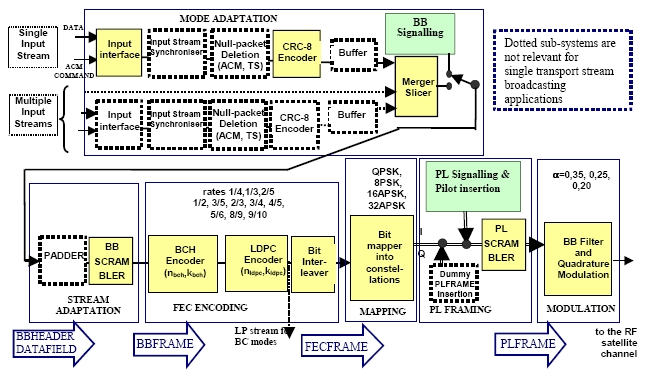

***Figure 3.4:** Functional block diagram of DVB-S2 ACM modem architecture*

### <a id="section-3.2.2"></a>3.2.2 Sub-Blocks Description

The following description of the subsystems is organized according to the functional block diagram in Figure [3.4](#fig:DVBSys).

#### Mode Adaptation

The DVB-S2 modem architecture deals with various input sequences:

- Single or multiple Transport Streams (TS), which are characterized by User Packets (UPs) of constant length equal to $`\,\mathrm{UPL} = 188\,\mathrm{bytes}`$ (one MPEG packet) whose first byte is a sync-byte ($`47_{\mathrm{HEX}}`$);

- Single or multiple Generic Streams (GS), which are characterized by continuous bit streams or streams of constant length user packets.

The first input bit is interpreted as the most significant bit (MSB). ACM command signalling allows setting of the transmission parameters to be adopted by the DVB-S2 modulator, for a specific portion of input data.

Since the DVB-S2 modulator may produce variable transmission delay on the user information, the Input Stream Synchronizer provides a means to guarantee a constant bit rate (CBR) and constant end-to-end transmission delay.

The identification and erasure of MPEG null-packets allow one to reduce the information rate and increase the error protection in the modulator. This process is carried out in a way that the removed null-packets can be re-inserted in the receiver in the exact place where they originally were. Specifications on this process are available in a dedicated annex in (*<span class="nocase">EN 302 307 v1.1.1 — Digital Video Broadcasting (DVB); Second generation framing structure, channel coding and modulation systems for Broadcasting, Interactive Services, News Gathering and other broadband satellite applications</span>* 2005).

A systematic Cyclic Redundancy Check (CRC) encoding is provided so that the receiver can detect the presence of errors in received streams. The CRC of 8 bits is inserted in the Base-Band Header (BBHEADER), which has the overall length of 80 bits. BBHEADERs contain also other signaling information such as indications on the roll-off factor of the shaping filter (Square Root Raised Cosine), the presence/absence of padding bits, Adaptive/Constant Coding Modulation, the use of identification and erasure of null-packet function, etc.

#### Stream Adaptation

Stream adaptation (see Figure [3.5](#fig:strformat)) provides padding to complete a constant length ($`k_{\mathrm{bch}}`$ bits) BBFRAME. $`k_{\mathrm{bch}}`$ depends on the FEC rate, as reported in Table [3.5](#tb:codpar). Padding may be applied in circumstances when the user data available for transmission are not sufficient to completely fill a BBFRAME, or when an integer number of UPs has to be allocated in a BBFRAME. The input stream consists of a BBHEADER followed by a DATA FIELD. The output stream will be a BBFRAME.

<a id="figure-3.5"></a><a id="fig:strformat"></a>

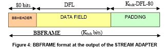

***Figure 3.5:** BBFRAME format at the output of the STREAM ADAPTER*

PADDING  
$`k_{\mathrm{bch}} - \mathrm{DFL}-80`$ zero bits are appended after the DATA FIELD so that the resulting BBFRAME has a constant length of $`k_{\mathrm{bch}}`$ bits. For Broadcast Service applications, $`\mathrm{DFL}= k_{\mathrm{bch}}-80`$, therefore no padding must be applied.

SCRAMBLING  
The complete BBFRAME should be randomized and the randomization sequence should be synchronous with the BBFRAME, starting from the MSB and ending after $`k_{\mathrm{bch}}`$ bits. Scrambling sequences are typically generated by feed-back shift registers. There are two main reasons why scrambling is used:

- It facilitates the work of a timing recovery circuit, automatic gain control and other adaptive circuits of the receiver (eliminating long sequences consisting of 0 or 1 only).

- It eliminates the dependence of a signal’s power spectrum upon the actual transmitted data, making it more dispersed to meet maximum power spectral density requirements (because if the power is concentrated in a narrow frequency band, it can interfere[^6] with adjacent channels due to the cross modulation and the intermodulation caused by non-linearities of the receiving tract).

#### FEC Encoding

This subsystem performs Outer Coding (BCH), Inner Coding (LDPC) and Bit Interleaving. The input stream is composed of BBFRAMEs and the output stream of FECFRAMEs.

Each BBFRAME ($`k_{\mathrm{bch}}`$ bits) is processed from the MSB to LSB by the FEC coding subsystem to generate a FECFRAME ($`n_{\mathrm{ldpc}}`$ bits). The parity check bits (BCHFEC) of the systematic BCH outer code must be appended after the BBFRAME and the parity check bits (LDPCFEC) of the inner LDPC encoder must be appended after the BCHFEC field, as shown in Figure [3.6](#fig:fecformat).

<a id="figure-3.6"></a><a id="fig:fecformat"></a>

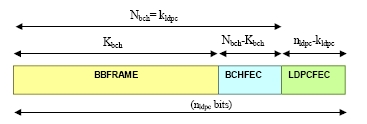

***Figure 3.6:** Format of data before Bit Interleaving*

For 8PSK, 16APSK, and 32APSK modulation formats, the output of the LDPC encoder is bit interleaved using a block interleaver (see Figure [3.7](#fig:BI) and Figure [3.8](#fig:BI35)). Data is serially written into the interleaver column-wise, and serially read out row-wise (the MSB of BBHEADER is read out first, except in the 8PSK rate 3/5 case where MSB of BBHEADER is read out third) as shown in the figures.

<a id="figure-3.7"></a><a id="fig:BI"></a>

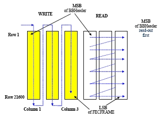

***Figure 3.7:** Bit Interleaving scheme for 8PSK (for each rate except 3/5) and normal FECFRAME length*

<a id="figure-3.8"></a><a id="fig:BI35"></a>

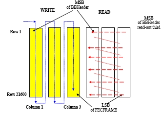

***Figure 3.8:** Bit Interleaving scheme for 8PSK (rate 3/5) and normal FECFRAME length*

<div class="center">

<a id="table-3.1"></a>

***Table 3.1:** Bit Interleaver structure*

| Modulation | Rows ($`n=64800`$) | Rows ($`n=16200`$) | Columns |
|:----------:|:------------------:|:------------------:|:-------:|
|    8PSK    |       21600        |        5400        |    3    |
|   16APSK   |       16200        |        4050        |    4    |
|   32APSK   |       12960        |        3240        |    5    |

</div>

#### Bit Mapping

Each FECFRAME (which is a sequence of 64800 bits for normal FECFRAME, or 16200 bits for short FECFRAME), must be serial-to-parallel converted (parallelism level $`\eta_{\mathrm{MOD}}`$= 2 for QPSK, 3 for 8PSK, 4 for 16APSK, 5 for 32APSK) in figures 9 to 12, the MSB of the FECFRAME is mapped into the MSB of the first parallel sequence. Each parallel sequence shall be mapped into the constellation, generating a $`(I,Q)`$ sequence of variable length depending on the selected modulation efficiency $`\eta_{\mathrm{MOD}}`$.

The input sequence is a FECFRAME, the output sequence is an XFECFRAME (compleX FECFRAME), composed of $`\frac{64800}{\eta_{\mathrm{MOD}}}`$ (normal XFECFRAME) or $`\frac{16200}{\eta_{\mathrm{MOD}}}`$ (short XFECFRAME) modulation symbols. Each modulation symbol is a complex vector in the format (I,Q) (I being the in-phase component and Q the quadrature component) or in the equivalent format $`\rho \exp(\mathrm{j}\phi)`$($`\rho`$ being the modulus of the vector and $`\phi`$ being its phase).

For QPSK, the System employs conventional Gray-coded QPSK modulation with absolute mapping (no differential coding). Bit mapping into the QPSK constellation is illustrated in Figure [3.1](#fig:Q8PSK). The normalized average energy per symbol is equal to $`\rho^2 = 1`$. Two FECFRAME bits are mapped to a QPSK symbol, i.e., bits $`2i`$ and $`2i+1`$ determine the $`i`$-th QPSK symbol, where $`i = 0 ,1 ,2 ,\ldots ,(N/2)-1`$ and $`N`$ is the coded LDPC block size.

For 8PSK, the System employs conventional Gray-coded 8PSK modulation with absolute mapping (no differential coding). Bit mapping into the 8PSK constellation is shown in Figure [3.1](#fig:Q8PSK). The normalized average energy per symbol is equal to $`\rho^2 = 1`$. For all the rates excluding $`3/5`$, bits $`3i ,3i+1 ,3i+2`$ of the interleaver output determine the $`i^{\mathrm{th}}`$ 8PSK symbol where $`i = 0 ,1 ,2 ,\ldots ,(N/3)-1`$and $`N`$ is the coded LDPC block size. For rate 3/5 bits $`3i+2 ,3i+1 ,3i`$ of the interleaver output determine the $`i`$-th 8PSK symbol where $`I = 0 ,1 ,2 ,\ldots ,(N/3)-1`$ and $`N`$ is the coded LDPC block size.

The 16APSK modulation constellation (see figure Figure [3.1](#fig:Q8PSK)) is composed of two concentric rings of uniformly spaced 4 and 12 PSK points, respectively in the inner ring of radius $`\rho_1`$ and outer ring of radius $`\rho_2`$. The ratio of the outer circle radius to the inner circle radius ($`\gamma =\rho_2/\rho_1`$) should comply with Table [3.3](#tb:16APSK_Radius). If $`4{\rho_1}^2+ 12{\rho_2}^2 = 16`$ the average signal energy becomes 1. Bits $`4i, 4i+1, 4i+2`$ and $`4i+3`$ of the interleaver output determine the $`i`$-th 16APSK symbol, where $`i = 0,1,2,\ldots ,(N/4)-1`$ and $`N`$ is the coded LDPC block size.

The 32APSK modulation constellation (see Figure [3.1](#fig:Q8PSK)) is composed of three concentric rings of uniformly spaced 4, 12 and 16 PSK points, respectively in the inner ring of radius $`\rho_1`$, the intermediate ring of radius $`\rho_2`$ and the outer ring of radius $`\rho_3`$. Table [3.2](#tb:32APSK_Radius) defines the values of $`\gamma_1 = \rho_2/\rho_1`$ and $`\gamma_2 = \rho_3/ \rho_1`$. If $`4{\rho_1}^2+ 12{\rho_2}^2+ 16{\rho_3}^2 = 32`$ the average signal energy becomes equal to 1. Bits $`5i ,5i+1 ,5i+2 ,5i+3`$ and $`5i+4`$ of the interleaver output determine the $`i`$-th 32APSK symbol, where $`i = 0 ,1 ,2 ,(N/5)-1`$.

<div class="center">

<div>

<a id="table-3.2"></a><a id="tb:32APSK_Radius"></a>

***Table 3.2:** Optimum constellation radius ratios $`\gamma_1`$ and $`\gamma_2`$ (linear channel) for 32APSK*

| Code Rate | $`\eta`$ | $`\gamma_1`$ | $`\gamma_2`$ |
|:---------:|:---------|:-------------|:-------------|
|    3/4    | 3,74     | 2,84         | 5,27         |
|    4/5    | 3,99     | 2,72         | 4,87         |
|    5/6    | 4,15     | 2,64         | 4,64         |
|    8/9    | 4,43     | 2,54         | 4,33         |
|   9/10    | 4,49     | 2,53         | 4,3          |

</div>

</div>

<div class="center">

<div>

<a id="table-3.3"></a><a id="tb:16APSK_Radius"></a>

***Table 3.3:** Optimum constellation radius ratio $`\gamma`$ (linear channel) for 16APSK*

| Code Rate | $`\eta`$ | $`\gamma`$ |
|:---------:|:--------:|:----------:|
|    2/3    |   2,66   |    3,15    |
|    3/4    |   2,99   |    2,85    |
|    4/5    |   3,19   |    2,75    |
|    5/6    |   3,32   |    2,7     |
|    8/9    |   3,55   |    2,6     |
|   9/10    |   3,59   |    2,57    |

</div>

</div>

#### Physical Layer (PL) Framing

This block generates, synchronously with FECFRAMEs, physical layer frames (PLFRAMEs) and deals with

- the insertion of physical headers and optional pilot symbols (their insertion causes a loss of 2,4% of capacity);

- the insertion of dummy frames to be used in absence of data ready to be immediately transmitted;

- the scrambling (or the randomization) for energy dispersal by multiplying the $`(I+\mathrm{j}Q)`$ samples by a complex randomization sequence $`(C_{\mathrm{I}}+ \mathrm{j}C_{\mathrm{Q}})`$.

## <a id="section-3.3"></a>3.3 Inner and Outer FEC

The DVB-S2 FEC section relies on the concatenation of two block codes, i.e., codewords generated by the BCH encoder are, in turn, encoded by the LDPC encoder[^7]. Thus, the BCH code is usually called *outer code* and LDPC *inner code*. Outputs from FEC encoding section are formatted according to Figure [3.6](#fig:fecformat). As we shall see later on, this BCH concatenation gives extra protection (*<span class="nocase">EN 302 307 v1.1.1 — Digital Video Broadcasting (DVB); Second generation framing structure, channel coding and modulation systems for Broadcasting, Interactive Services, News Gathering and other broadband satellite applications</span>* 2005) against unwanted error floors at high SNR[^8] When the decoding has to be performed, the above sequence of encoding steps must be, of course, inverted: in other words, LDPC starts to decode prior to BCH. As just said, error floor phenomena at high signal-to-noise ratio typically affect the decoding performance, and therefore the BCH extra protection against residual errors is aimed at counteracting the performance degradation, enhancing FEC robustness at higher SNR.

In some sense, the chain constituted, in order, by LDPC encoder, channel and LDPC decoder can be conceived as a super-channel on which BCH encoder/decoder operates. This kind of intuitive representation highlights the advantage of concatenating two codes. The best choices on their kind of concatenation can give a powerful tool to enhance the performance of the overall FEC decoding, allowing one to act by an outer coding on the weaknesses of the inner coding.

### <a id="section-3.3.1"></a><a id="sec:BCHstruct"></a>3.3.1 BCH

BCH code is named for Bose, Ray-Chaudhury, and Hocquenghem, who published work in 1959 and 1960 which revealed a means of designing codes over $`GF(2)`$ with a specified design distance. BCH codes are cyclic codes and thus, as explained in Appendix B, can be specified by a generator polynomial. In the present Section we give only some notation on the particular, as we shall see, structure of the BCH code employed in DVB-S2 and, more generally, on its design steps.

A BCH code of length $`n`$ with a specified minimum distance, i.e., capable of correcting (at least) $`t`$ errors, can be designed as follows (Moon 2005; F. J. MacWilliams, N. J. Sloane 1977):

1.  Determine the smallest $`m`$ such that $`GF(q^m)`$ has a primitive $`n`$th root (Section [A.5](10-galois-or-finite-fields.md#sec:factoring)) of unity $`\beta`$.

2.  Select a nonnegative integer $`b`$. In most cases, it is selected $`b=1`$.

3.  Write down a list of $`2t`$ consecutive powers of $`\beta`$ (see Section [A.3](10-galois-or-finite-fields.md#sec:MathSurvey)):
    ``` math
    \beta^b ,\beta^{b+1} ,\ldots ,\beta^{b+2t-1}
    ```
    Determine the minimal polynomial of each of these powers of $`\beta`$. (Because of conjugacy, frequently these minimal polynomials are not distinct.)

4.  The generator polynomial $`g(x)`$ is the least common multiple (LCM) of these minimal polynomials. The code is a $`(n,n-\mathrm{deg}(g(x)))`$ cyclic code.

Two fields are involved in the construction of the BCH codes. The small field $`GF(q)`$ is where the generator polynomial has its coefficients and is the field where the elements of the codeword are. The big field $`GF(q^m)`$ is the field where the generator polynomial has its roots. For encoding purposes it is sufficient to have the polynomial generator of the code, whereas, for decoding, the additional knowledge of the extension field where the generator has its roots is necessary. Two definitions will be useful later on: first, if $`\beta`$ selected is a primitive element then the code is called *primitive*; second, when $`\beta=1`$ the code is said to be a code in *narrow-sense*.

It can be proved that following the constructive procedure described above produces codes with at least the specified minimum distance. As shown in Appendix B, since every codeword is a multiple of the generator polynomial, we can express the *parity check condition* as follows <a id="eq-3.10"></a>
``` math
\begin{equation}
c(\beta^i)=m(\beta^i)g(\beta^i)=m(\beta^i)\cdot 0
 \tag{3.10}
\end{equation}
```
for $`i=b ,b+1 ,\ldots ,b+2t-1`$. In fact these powers of $`\beta`$ are, by design, the roots of $`g(x)`$. Rewriting these conditions using the corresponding vector representation we get the following system of equations <a id="eq-3.11"></a>
``` math
\begin{equation}
c_0+c_1\beta^i+c_2\beta^{i+1}+\ldots+c_{n-1}{(\beta^{i})}^{n-1}=0
 \tag{3.11}
\end{equation}
```
always for $`i=b ,b+1 ,\ldots ,b+2t-1`$. Therefore $`2t`$ parity check conditions can also be expressed in the matrix form <a id="eq-3.12"></a><a id="eq:pchk"></a>
``` math
\begin{equation}
\left(
\begin{array}{ccccc}
  1 & \beta^i & \beta^{2i} & \cdots & \beta^{(n-1)i}
\end{array} \right)
\left(
\begin{array}{c}
  c_0 \\
  c_1 \\
  c_2 \\
  \vdots \\
  c_{n-1}
\end{array}
\right)
=0
 \tag{3.12}
\end{equation}
```
Stacking the row vectors for different values of $`i`$ we get the following parity check matrix <a id="eq-3.13"></a>
``` math
\begin{equation}
\left(
  \begin{array}{ccccc}
    1 & \beta^b & \beta^{2b} & \ldots & \beta^{(n-1)b} \\
    1 & \beta^{b+1} & \beta^{2(b+1)} & \ldots & \beta^{(n-1)(b+1)} \\
    \vdots &  &  &  &  \\
    1 & \beta^{b+\delta-3} & \beta^{2(b+\delta-3)} & \ldots & \beta^{(n-1)(b+\delta-3)} \\
    1 & \beta^{b+\delta-2} & \beta^{2(b+\delta-2)} & \ldots & \beta^{(n-1)(b+\delta-2)} \\
  \end{array}
\right)
 \tag{3.13}
\end{equation}
```
where $`\delta=2t+1`$ represents the *design distance* (Hamming metric) of the code.

It can be proved (see (Moon 2005)) that the matrix $`\mathbf{H}`$ has at least $`\delta = 2t+1`$ columns linearly dependent and, thus, the minimum distance of the code satisfies $`d_{\mathrm{min}} \geq \delta`$; that is, the code is capable of correcting at least $`t`$ errors.

In the DVB-S2 context, the BCH outer code has been designed to avoid “unpredictable and unwanted error floors which affect iterative decodings at high $`C/N`$ ratios”, i.e., at low bit error rates (BER).

Although the mathematical background shown in this thesis for design, encoding and decoding is completely general, in most practical cases the base field of BCH codes is $`GF(2)`$, as in DVB-S2 FEC section. The polynomials which must be multiplied in order to obtain the wanted BCH code associated to a specific operating mode (i.e., error correction capability) are shown in Table [3.4](#tb:BCHpoly). More specifically, multiplication of the first $`t`$ of them provides a polynomial generator of the BCH code capable of correcting at least $`t`$ errors. Notice that this procedure is in accordance with the third step to construct the generator polynomial of the BCH code.

The encoding suggestions, provided in (*<span class="nocase">EN 302 307 v1.1.1 — Digital Video Broadcasting (DVB); Second generation framing structure, channel coding and modulation systems for Broadcasting, Interactive Services, News Gathering and other broadband satellite applications</span>* 2005), are typical of cyclic codes in systematic form, whose specific properties and encoding steps are discussed in dedicated Appendix B. It is worth understanding that both systematic and non-systematic codewords are always multiples of the generator polynomial of the code (i.e., of the ideal, as also shown in Section [B.2](11-cyclic-codes.md#sec:ideals)) so that the parity check condition ([3.12](#eq:pchk)) is still valid as well as the BCH bound. Furthermore, from a direct analysis of the polynomials supplied by (*<span class="nocase">EN 302 307 v1.1.1 — Digital Video Broadcasting (DVB); Second generation framing structure, channel coding and modulation systems for Broadcasting, Interactive Services, News Gathering and other broadband satellite applications</span>* 2005) (Normal FEC-Frame), one could observe that these specific codes (one for each selected error protection level) are *primitive* and, indeed, *narrow-sense*. The reasons are described in the following:

- $`g_1(x)`$ is one of the possible primitive polynomials which have their roots in $`GF(2^{16})`$. This can be quickly proved by verifying that $`\alpha^{2^{16}-1}=1`$ by computer aid or, more lazily, by direct consultation of any table of primitive polynomials. For the tables of primitive polynomials, the interested reader could refer to (Stephen B. Wicker 1995).

- Hence, this BCH is a narrow-sense code. In fact, by design, it follows that $`b`$ must be equal to 1.

Three different t-error correcting BCH codes ($`t=12`$, $`t = 10`$, $`t=8`$) should be applied to each BBFRAME, according to LDPC coding rates as shown in Table [3.5](#tb:codpar). Outer FEC (i.e., BCH), although there are 11 LDPC coding rates, deals with only three different error protection levels: $`t=12 ,t=10 ,t=8`$. On the one hand we have, since this BCH is primitive, that the codeword length must be equal to $`2^{16}-1`$. On the other hand we have in Table [3.5](#tb:codpar) multiple codeword lengths for each t-BCH code and none of them corresponds to the primitive length BCH should have. In general, for each code rate, a different set of polynomials to be multiplied would be expected, whereas, in DVB-S2, there is only one set of polynomials provided by (*<span class="nocase">EN 302 307 v1.1.1 — Digital Video Broadcasting (DVB); Second generation framing structure, channel coding and modulation systems for Broadcasting, Interactive Services, News Gathering and other broadband satellite applications</span>* 2005).

Eventually, we have to conclude that the DVB-S2 BCH code is *shortened*. A systematic $`(n,k)`$ code can be shortened by setting a number of the information bits to zero (i.e., zero padding). This means that a linear $`(n,k)`$ code consisting of $`k`$ information bits and $`n-k`$ check bits (or redundancy bits) can be shortened into a $`(n-l ,k-l)`$ linear code by setting the most (or the least, depending on the reference direction) significant first $`l`$ bits to zero. As also described in (Moon 2005), shortening of a code does not have bad effects on its minimum distance properties and its decoding algorithms. However, shortened cyclic code might lose its cyclic property.

<div>

<a id="table-3.4"></a><a id="tb:BCHpoly"></a>

***Table 3.4:** BCH minimal polynomials for normal FECFRAME $`n_{\mathrm{LDPC}}=64800`$*

|  |  |
|:--:|:---|
| $`g_1(x)`$ | $`1+x^2+x^3+x^5+x^{16}`$ |
| $`g_2(x)`$ | $`1+x+x^4+x^5+x^6+x^8+x^{16}`$ |
| $`g_3(x)`$ | $`1+x^2+x^3+x^4+x^5+x^7+x^8+x^9+ x^{10}+x^{11}+x^{16}`$ |
| $`g_4(x)`$ | $`1+x^2+x^4+x^6+x^9+x^{11}+ x^{12}+x^{14}+x^{16}`$ |
| $`g_5(x)`$ | $`1+x+x^2+x^3+x^5+x^{8}+ x^{9}+x^{10}+x^{11}+x^{12}+x^{16}`$ |
| $`g_6(x)`$ | $`1+x^2+x^4+x^5+x^7+x^{8}+ x^{9}+x^{10}+x^{12}+x^{13}+x^{14}+x^{15}+x^{16}`$ |
| $`g_7(x)`$ | $`1+x^2+x^5+x^6+x^8+x^{9}+ x^{10}+x^{11}+x^{13}+x^{15}+x^{16}`$ |
| $`g_8(x)`$ | $`1+x+x^2+x^5+x^6+x^{8}+ x^{9}+x^{12}+x^{13}+x^{14}+x^{16}`$ |
| $`g_9(x)`$ | $`1+x^5+x^{7}+ x^{9}+x^{10}+x^{11}+x^{16}`$ |
| $`g_{10}(x)`$ | $`1+x+x^2+x^5+x^7+x^{8}+ x^{10}+x^{12}+x^{13}+x^{14}+x^{16}`$ |
| $`g_{11}(x)`$ | $`1+x+x^2+x^3+x^5+x^{9}+ x^{11}+x^{12}+x^{13}+x^{16}`$ |
| $`g_{12}(x)`$ | $`1+x+x^5+x^6+x^{7}+ x^{9}+x^{11}+x^{12}+x^{16}`$ |

</div>

<div>

<a id="table-3.5"></a><a id="tb:codpar"></a>

***Table 3.5:** Coding parameters for normal FECFRAME $`n_{\mathrm{LDPC}}=64800`$*

|           |             |           |        |             |
|:---------:|:-----------:|:---------:|:------:|:-----------:|
| LDPC Code | BCH Uncoded | BCH Coded | BCHFEC | BCH t-error |
|   Rate    |    Block    |   Block   |        | Correction  |
|    1/4    |    16008    |   16200   |  192   |     12      |
|    1/3    |    21408    |   21600   |  192   |     12      |
|    2/5    |    25728    |   25920   |  192   |     12      |
|    1/2    |    32208    |   32400   |  192   |     12      |
|    3/5    |    38688    |   38880   |  192   |     12      |
|    2/3    |    43040    |   43200   |  160   |     10      |
|    3/4    |    48408    |   48600   |  192   |     12      |
|    4/5    |    51648    |   51840   |  192   |     12      |
|    5/6    |    53840    |   54000   |  160   |     10      |
|    8/9    |    57472    |   57600   |  128   |      8      |
|   9/10    |    58192    |   58320   |  128   |      8      |

</div>

### <a id="section-3.3.2"></a>3.3.2 LDPC

LDPC codes (Robert Gallagher 1963) were invented in 1960 by R. Gallager. They were largely ignored until the discovery of turbo codes (Claude Berrou, Alain Glavieux, Punya Thitimajshima 1993) in 1993. Since then, LDPC codes have experienced a renaissance and are now one of the most intensely studied areas in coding.

Much of the effort in coding over the last 50 years has focused on the construction of highly structured codes with large minimum distance. The structure keeps the decoding complexity manageable, while large minimum distance is supposed to guarantee good performance. This approach, however, is not without its drawbacks. First, it seems that finding structured codes with large minimum distance turns out to be a harder problem than researchers imagined. Finding good codes in general is, in a sense, trivial: randomly chosen codes are good with high probability. More generally, one can easily construct good codes provided one admits sufficient *description complexity* into the definition of the code. This conflicts, however, with the goal of finding highly structured codes that have simple decodings. Second, close to capacity, minimum distance is only a poor surrogate for the performance measure of real interest. Iterative coding systems take an entirely different approach. The basic idea is the following. Codes are constructed so that the relationship between their bits (the structure of their redundancy) is *locally* simple, admitting simple *local decoding*. The local descriptions of the codes are interconnected in a complex (e.g., random- like) manner, introducing long-range relationships between the bits. Relatively high global description complexity is thereby introduced in the interconnection between the simple local structures. Iterative decoding proceeds by performing the simple local decodings and then exchanging the results, passing messages between locales across the ‘complex’ interconnection. The locales repeat their simple decodings, taking into account the new information provided to them from other locales. Usually, one uses a graph to represent this process. *Locales* are nodes in the graph, and interconnections are represented as edges. Thus, description complexity is introduced without adding computational complexity per se, but rather as wiring or routing complexity.

In addition to the classical representation of block codes (i.e., by the $`\mathbf{H}`$ matrix), another useful and common way of representing an LDPC code is through a graphical representation called a *Tanner graph* (Robert Gallagher 1963; Moon 2005; David J.C. MacKay 2003). Tanner graphs of LDPC codes are bipartite graphs with variable nodes on one side and constraint nodes on the other. Each variable node corresponds to a bit, and each constraint node corresponds to one parity-check constraint on the bits defining a codeword. A parity-check constraint applies to a certain subset of the codeword bits, those that participate in the constraint. The parity-check is satisfied if the XOR of the participating bits is 0 or, equivalently, the modulo 2 sum of the participating bits is 0. Edges in the graph attach variable nodes to constraint nodes indicating that the bit associated with the variable node participates in the parity-check constraint associated with the constraint node. A bit sequence associated with the variable nodes is a codeword if and only if all of the parity-checks are satisfied.

<a id="figure-3.9"></a><a id="fig:sparseH"></a>

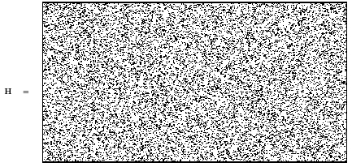

***Figure 3.9:** A low-density parity-check matrix with $`N = 20000`$ columns of weight $`j = 3`$ and $`M = 10000`$ rows of weight $`k = 6`$ (reference (David J.C. MacKay 2003)).*

The Tanner graph representation of the LDPC code closely mirrors the more standard parity-check matrix representation of a code. In this latter description the code is represented as the set of all binary solutions $`\mathbf{x} = (x_1 ,x_2 ,\ldots ,x_n)`$ to a simple linear algebraic equation (parity check equations (F. J. MacWilliams, N. J. Sloane 1977; Stephen B. Wicker 1995; Moon 2005; David J.C. MacKay 2003)) $`\mathbf{H} \mathbf{x}^{\mathrm{T}} = \mathbf{0}^{\mathrm{T}}`$. The elements of the parity-check matrix are 0s and 1s, and all arithmetic is modulo 2, that is, multiplication of $`\mathbf{x}`$ by a row of $`\mathbf{H}`$ means taking the XOR of the bits in $`\mathbf{x}`$ corresponding to the 1s in the row of $`\mathbf{H}`$. The connection between the parity-check matrix representation and the Tanner graph is straightforward, and is illustrated in Figure [3.10](#fig:Tanner) by means of an example. The elements of $`\mathbf{x}`$ are in one-to-one correspondence with the variable nodes in the Tanner graph. Thus, the variable nodes correspond to the columns of $`\mathbf{H}`$. The parity checks on $`\mathbf{x}`$ are in one-to-one correspondence with the constraint nodes in the Tanner graph. Thus, the constraint nodes correspond to the rows of $`\mathbf{H}`$. The edges in the Tanner graph correspond to the 1s in $`\mathbf{H}`$, that is, the entry in the $`i`$-th row and $`j`$-th column of $`\mathbf{H}`$ is a 1 if and only if the $`i`$-th constraint node is connected to the $`j`$-th variable node in the Tanner graph.

The Tanner graph captures the dependency structure of the various bits. The iterative decoding algorithms we will discuss work directly on this bipartite graph. Iterative algorithms for LDPC codes are message-passing and flipping algorithms, both introduced by Gallager (Robert Gallagher 1963).

<a id="figure-3.10"></a><a id="fig:Tanner"></a>

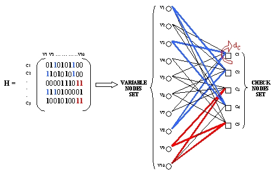

***Figure 3.10:** A parity check matrix $`\mathbf{H}`$ and the corresponding Tanner graph. To illustrate the relationship more clearly, some edges are shown in red or blue.*

#### Iterative Decodings and Message-Passing

In *message-passing* decoders, messages are exchanged along the edges of the graph, and computations are performed at the nodes, as shown in Figure [3.11](#fig:Belief). Each message represents an estimate of the bit associated with the edge carrying the message. These decoders can be understood by focusing on one bit as follows. Suppose the bits of an LDPC codeword are transmitted over a communications channel and, during transmission, some of them are corrupted so that a 1 becomes a 0 or vice versa. Each bit node in the decoder gets to see the bit that arrived at the receiver corresponding to the one that was transmitted from the equivalent node at the transmitter. Imagine that the node would like to know if that bit is in error or not and therefore asks all of its neighboring check nodes what they think the bit’s value should be. Each neighboring check node then asks its other neighbors what their bit values are and sends back to the original bit node the modulo 2 sum of those values. The bit node now has several opinions as to the bit’s correct value and must somehow reconcile these opinions; it could, for example, take a majority vote. The above procedure constitutes one round or iteration of message passing.

<a id="figure-3.11"></a><a id="fig:Belief"></a>

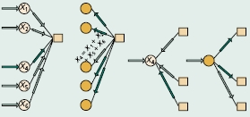

***Figure 3.11:** The principle of a message-passing decoder. Messages represent an estimate of the bit associated with the edge carrying the message. Nodes query neighboring nodes to collect opinions, process this information, and forward their current estimate to their neighbors.*

In order to improve performance, a further such round can be performed. In more detail, assume that those bit nodes that send their observed bits to the checks to be summed first ask their check node neighbors what they think is their correct bit value. Those check nodes could then query their other variable node neighbors and forward their modulo 2 sum as an opinion. With more information now available, the bit nodes would have a better chance of communicating the correct value to the check nodes, and the opinions returned to the original node would therefore have a better chance of being correct. This gathering of opinions could obviously be extended through multiple iterations; typically, many iteration rounds are performed.

In actual decoding all nodes decode concurrently. Each node gathers opinions from all its neighbors and forwards to each neighbor an opinion formed by combining the opinions of the other neighbors. This is the source of the term message passing. The process continues until either a set of bits is found that satisfies all checks or time runs out. The message passing may proceed asynchronously. Note that with LDPC codes, convergence to a codeword is easy to detect since one need only verify that the parity checks are satisfied.

The processing required for message-passing decoding of LDPC codes is highly parallelizable and flexible. Each message-passing operation performed at a node depends on other nodes only through the messages that arrive at that node. Moreover, message updating need not be synchronized. Consequently, there is great freedom to distribute in time and space the computation required to decode LDPC codes. Turbo codes are also decoded using belief propagation, but their structure does not admit the same level of atomization.

There is a second distinct class of decoding algorithms that is often of interest for very high speed applications, such as optical networking. This class of algorithms is known as flipping algorithms. Bit flipping usually operates on hard decisions: the information exchanged between neighboring nodes in each iteration is a single bit. The basic idea of flipping is that each bit, corresponding to a variable node assumes a value, either 0 or 1, and, at certain times, decides whether to flip itself (i.e., change its value from a 1 to a 0 or vice versa). That decision depends on the state of the neighboring check nodes under the current values. If enough of the neighboring checks are unsatisfied, the bit is flipped. The notion of ‘enough’ may be time-varying, and it may also depend on soft information available about the bit. Thus, under flipping, variable nodes inform their neighboring check nodes of their current value, and the check nodes then return to their neighbors the parity of their values. The underlying assumption is that bits that are wrong will tend to have more unsatisfied neighbors than bits that are correct.

#### Encoding Procedure for The DVB-S2 Code

The LDPC code of the DVB-S2 standard has the following structure (see Annex A in (*<span class="nocase">TR 102 376 v1.1.1 — Digital Video Broadcasting (DVB); User guidelines for the second generation system for Broadcasting, Interactive Services, News Gathering and other broadband satellite applications (DVB-S2)</span>* 2005))

<a id="eq-3.14"></a>
``` math
\begin{equation}
\mathbf{H} = \left[
\begin{array}{c|c}
\mathbf{H}^{\mathrm{d}} & \mathbf{H}^{\mathrm{p}}
\end{array} \right]
 \tag{3.14}
\end{equation}
```
where $`\mathbf{H}^{\mathrm{d}}`$ is an $`r \times k`$ matrix, and $`\mathbf{H}^{\mathrm{p}}`$ is a dual diagonal $`r \times r`$ matrix that is shown below as an example ($`r=5`$)

<a id="eq-3.15"></a>
``` math
\begin{equation}
\mathbf{H}^{\mathrm{p}} = \left(
\begin{array}{ccccc}
1 & 0 & 0 & 0 & 0\\
1 & 1 & 0 & 0 & 0\\
0 & 1 & 1 & 0 & 0\\
0 & 0 & 1 & 1 & 0\\
0 & 0 & 0 & 1 & 1
\end{array} \right)
 \tag{3.15}
\end{equation}
```
The notation in use is the same as that employed so far in the standard description, that is, $`r= n-k`$ represents the number of redundancy bits, $`n`$ the codeword length, and $`k`$ the length of messages to be encoded. For now, it does not matter which rate the LDPC code has: clearly the size of $`\mathbf{H}`$ changes with the coding rate, and so does its composition.

Codewords, represented by vector $`\mathbf{x}`$, can be divided into a systematic part, namely $`\mathbf{s}`$, and a part relevant to the redundancy (parity) bits, namely $`\mathbf{p}`$, in such a way that vector $`\mathbf{x}`$ can be expressed as $`\mathbf{x}=(\mathbf{s},\mathbf{p})^{\mathrm{T}}`$. The encoding is accomplished by searching the parity vector $`\mathbf{p}`$ which satisfies the (system) equation $`\mathbf{Hx}= \mathbf{0}`$. This system, as the $`\mathbf{x}`$, can be divided into two contributions as follows <a id="eq-3.16"></a>
``` math
\begin{equation}
\mathbf{H}^{\mathrm{d}} \mathbf{s} + \mathbf{H}^{\mathrm{p}} \mathbf{p}= \mathbf{0} \text{     or     } \mathbf{H}^{\mathrm{d}} \mathbf{s} =\mathbf{H}^{\mathrm{p}} \mathbf{p}= \mathbf{v}
 \tag{3.16}
\end{equation}
```
which is obviously equivalent to that given before.

So the encoding process can be carried out through two steps:

1.  Determine the auxiliary vector $`\mathbf{v}=\mathbf{H}^{\mathrm{d}}\mathbf{s}`$. The number of XOR operations to be performed is $`(n-k)\cdot(d_{\mathrm{c}}-1)`$, where $`d_{\mathrm{c}}`$ is the number of 1s in a row of $`\mathbf{H}^{\mathrm{d}}`$, which is constant in a regular LDPC.

2.  Determine the $`r`$ parity bits by a back substitution, using the equation $`\mathbf{H}^{\mathrm{p}}\mathbf{p} = \mathbf{v}`$, i.e., <a id="eq-3.17"></a>
    ``` math
    \begin{equation}
    \begin{aligned}
    p_1 &= v_1 \\
    p_l &= v_l + p_{l-1}  & \text{for } l= 1 ,2 ,\ldots,r
    \end{aligned}
     \tag{3.17}
    \end{equation}
    ```
    Here the number of operations (XOR) required is $`r-1`$. This is actually a matrix inversion process, which can be executed at almost no cost because the matrix is bi-diagonal.

The encoder structure is shown in Figure [3.12](#fig:LDPCENC). The overall number of operations to be performed is $`n(1-R)(d_{\mathrm{c}}-1)`$ ($`R`$, as usually indicated in the vast majority of literature, is the code rate) and thus the encoder complexity grows linearly with $`n`$.

<a id="figure-3.12"></a><a id="fig:LDPCENC"></a>

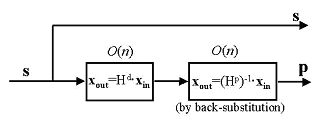

***Figure 3.12:** Encoding process of random-like LDPC codes*

The very regular structure of the $`\mathbf{H}`$ matrix allows one to minimize the amount of memory to be allocated so as to succeed in storing the positions of the ones in it even when using brute force to do that. However, the full matrix, during the encoding, is recovered from compressed information, which is contained in dedicated tables for each, of course, coding rate provided.

For example, only the location of the ones in the first column of $`\mathbf{H}^{\mathrm{d}}`$ is described by the table (in the first table row) in the standard: the following 359 columns are obtained through a cyclic shift of the first column of a number of locations starting from the first column. In the same way, only the location of the ones in the 361st column of H is described by the table (second table row) in the standard: the following 359 columns are obtained via a cyclic shift of a number of locations starting from the 361st column. This procedure is followed up to the last ($`k`$-th) column of $`\mathbf{H}^{\mathrm{d}}`$.

Let us now recall the procedure indicated by ETSI in (*<span class="nocase">EN 302 307 v1.1.1 — Digital Video Broadcasting (DVB); Second generation framing structure, channel coding and modulation systems for Broadcasting, Interactive Services, News Gathering and other broadband satellite applications</span>* 2005). The DVB-S2 LDPC encoder systematically encodes an information block of size $`k_{\mathrm{ldpc}}`$, $`\mathbf{i}= (i_0,i_1,i_2,\ldots ,i_{k_{\mathrm{ldpc}}})`$ onto a codeword of size $`n_{\mathrm{ldpc}}`$, $`\mathbf{c}=(i_0,i_1 ,\ldots ,p_0,p_1 ,\ldots ,p_{n_{\mathrm{ldpc}}-k_{\mathrm{ldpc}}-1})`$. The transmission of codewords starts in the given order from $`i_0`$ and ends with $`p_{n_{\mathrm{ldpc}}-k_{\mathrm{ldpc}}-1}`$. LDPC code parameters $`(n_{\mathrm{ldpc}},k_{\mathrm{ldpc}})`$ are given in table These last two parameters depend on the coding rate and the code block size, which may be either normal or short.

The procedure to calculate the parity bits for each kind of block is the following

- Set all the parity bits to zero, that is, $`p_0=p_1=\ldots=p_{n_{\mathrm{ldpc}}-k_{\mathrm{ldpc}}-1}=0`$

- Accumulate the first information bit, namely $`i_0`$, at the parity address specified in the first row of Tables B1 through B8 in Annex B (*<span class="nocase">EN 302 307 v1.1.1 — Digital Video Broadcasting (DVB); Second generation framing structure, channel coding and modulation systems for Broadcasting, Interactive Services, News Gathering and other broadband satellite applications</span>* 2005).

- The structure of the $`\mathbf{H}`$ matrix can now be exploited in this way: the second column, indicating over which element of the output the second information bit is accumulated, can be obtained from the first column, and so on for the other columns. Hence

  - For the next 359 information bits accumulate $`i_m`$ at parity bit addresses $`\left\{ x + (r \mod 360\times q)\right\} \mod (n_{\mathrm{ldpc}}-k_{\mathrm{ldpc}})`$ where $`x`$ denotes the address of the parity bit accumulator corresponding to the first bit $`i_0`$, and $`q`$ is a code rate dependent constant specified in Table 7a in (*<span class="nocase">EN 302 307 v1.1.1 — Digital Video Broadcasting (DVB); Second generation framing structure, channel coding and modulation systems for Broadcasting, Interactive Services, News Gathering and other broadband satellite applications</span>* 2005).

  - For the 361st information bit $`i_{\mathrm{360}}`$, the addresses of parity bit accumulators are given in the second row of the tables B1 through B8 in Annex B (*<span class="nocase">EN 302 307 v1.1.1 — Digital Video Broadcasting (DVB); Second generation framing structure, channel coding and modulation systems for Broadcasting, Interactive Services, News Gathering and other broadband satellite applications</span>* 2005). In a similar way the addresses of the parity bit accumulators for the following 359 information bits, namely $`i_m ,i=361,362 ,\ldots ,719`$, are obtained using the formula $`\left\{ x + (r \mod 360\times q)\right\} \mod (n_{\mathrm{ldpc}}-k_{\mathrm{ldpc}})`$ where $`x`$ denotes the address of the parity bit accumulator corresponding to the information bit $`i_{360}`$, i.e., the entries in the second row of the tables B1 through B8 in Annex B (*<span class="nocase">EN 302 307 v1.1.1 — Digital Video Broadcasting (DVB); Second generation framing structure, channel coding and modulation systems for Broadcasting, Interactive Services, News Gathering and other broadband satellite applications</span>* 2005).

- In a similar manner, for every group of 360 new information bits, a new row from tables B1 through B8 in Annex B (*<span class="nocase">EN 302 307 v1.1.1 — Digital Video Broadcasting (DVB); Second generation framing structure, channel coding and modulation systems for Broadcasting, Interactive Services, News Gathering and other broadband satellite applications</span>* 2005) is used to find the addresses of the parity bit accumulators.

After all of the information bits are exhausted, the final parity bits are obtained as follows (this is the back substitution introduced before, now executed in-place, i.e., with no use of auxiliary vector):

- Sequentially perform the following operations starting with $`i=1`$ <a id="eq-3.18"></a>
  ``` math
  \begin{equation}
  p_i = p_i + p_{i-1},\text{          } i= 0 ,1 ,\ldots,n_{\mathrm{ldpc}}-k_{\mathrm{ldpc}}-1
   \tag{3.18}
  \end{equation}
  ```

- Final content of $`p_i ,i= 0 ,1 ,\ldots,n_{\mathrm{ldpc}}-k_{\mathrm{ldpc}}-1`$ is equal to the parity bit $`p_i`$.

The following considerations can be made:

1.  The sparse matrix $`\mathbf{H}^{\mathrm{d}}`$ is constituted by $`N_{\mathrm{S}}`$ sub-matrices (number of rows of tables B1 through B8) with $`r`$-rows and 360-columns, each of which is specified by a row of the tables B1 through B8; in detail, addresses of ones in the first column of each matrix is specified by a row of these tables.

2.  Each column of the sub-matrices constituting $`\mathbf{H}^{\mathrm{d}}`$ can be obtained via a cyclic shift of the first column, in which the shift is of a number of positions (rows) equal to $`q`$. The shift is cyclic since it is reduced modulo $`m`$, the number of the rows of each sub-matrix.

3.  $`\mathbf{H}^{\mathrm{d}}`$ has a fixed number of ones per row ($`d_{\mathrm{c}}`$), depending on coding rate.

4.  Number of ones per column in each sub-matrix is not fixed; tables B1 through B8 in fact have **col1** columns in the first **row1** rows and **col2** columns for **row2** (=$`N_{\mathrm{S}}`$-row1) rows; this means that first **row1** sub-matrices of $`\mathbf{H}^{\mathrm{d}}`$ have **col1** ones per column, while **row2** sub-matrices have **col2** ones per column.

5.  $`\mathbf{H}^{\mathrm{p}}`$ is a $`r \times r`$ bi-diagonal matrix.

<a id="figure-3.13"></a><a id="fig:LDPCProd"></a>

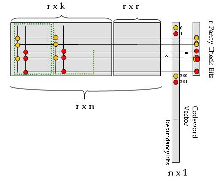

***Figure 3.13:** Regularity properties of the LDPC generation matrix*

The code rate dependent constant $`q`$ (introduced in the previous paragraph) allows a division of the total number $`r`$ of check equations in q congruence classes; each of them has 360 equations ($`r=360\cdot q`$). From this point of view and considering tables associated with the LDPC coding procedure, a parity check equation can be identified by a pair of parameters $`R`$ and $`Q`$: the congruence class ($`R_x`$) and the position ($`Q_x`$) in the congruence class. These parameters are obtained from the following relations: <a id="eq-3.19"></a><a id="eq-3.19a"></a><a id="eq-3.19b"></a>
``` math
\begin{align}
R_x &= B_x \mod q  \tag{3.19a}\\
Q_x &= \frac{B_x}{q}
 \tag{3.19b}\end{align}
```
where $`B_x`$ is a generic element of address tables B1 through B8, $`0<R<q-1`$ and $`0<Q<359`$. These tables are used to address systematic bits to the corresponding check equation.

All parameters of the encoding procedure are summarized in Table [3.6](#tb:LDPCENCPAR), where in order from left to right we have:

1.  Rate: LDPC coding rate

2.  $`r=n-k`$: number of code parity bits

3.  $`q = 180\cdot (1-R)`$: code rate dependent constant

4.  $`d_{\mathrm{c}}`$: check nodes degree (number of bits per parity check equation)

5.  $`N_{\mathrm{S}}=180-q=k/360= \mathbf{row1}+\mathbf{row2}`$: number of sub-matrices $`r\times 360`$ of $`\mathbf{H}^{\mathrm{NS}}`$

6.  **row1**: number of sub-matrices with **col1** ones per column

7.  **row2**: number of sub-matrices with **col2** ones per column

8.  **col1**: variable nodes degree with $`0<index<360\cdot \mathbf{row1}`$

9.  **col2**: variable nodes degree with $`360\cdot \mathbf{row1}<index< k`$

10. \#Bx: total number of elements in tables B1 through B8

<div class="center">

<div>

<a id="table-3.6"></a><a id="tb:LDPCENCPAR"></a>

***Table 3.6:** LDPC parameters for the encoding procedure.*

| Rate | $`d_{\mathrm{c}}`$ | $`q`$ | $`N_{\mathrm{S}}`$ | $`k`$ bit | $`r`$ bit | **row1** | **row2** | **col1** | **col2** | \#Bx |
|:--:|:--:|:--:|:--:|:--:|:--:|:--:|:--:|:--:|:--:|:--:|
| 1/4 | 2 | 135 | 45 | 16200 | 48600 | 15 | 30 | 12 | 3 | 270 |
| 1/3 | 3 | 120 | 60 | 21600 | 43200 | 20 | 40 | 12 | 3 | 360 |
| 2/5 | 4 | 108 | 72 | 25920 | 38880 | 24 | 48 | 12 | 3 | 432 |
| 1/2 | 5 | 90 | 90 | 32400 | 32400 | 36 | 54 | 8 | 3 | 450 |
| 3/5 | 9 | 72 | 108 | 38880 | 25920 | 36 | 72 | 12 | 3 | 648 |
| 2/3 | 8 | 60 | 120 | 43200 | 21600 | 12 | 108 | 13 | 3 | 480 |
| 3/4 | 12 | 45 | 135 | 48600 | 16200 | 15 | 120 | 12 | 3 | 540 |
| 4/5 | 16 | 36 | 144 | 51840 | 12960 | 18 | 126 | 11 | 3 | 576 |
| 5/6 | 20 | 30 | 150 | 54000 | 10800 | 15 | 135 | 13 | 3 | 600 |
| 8/9 | 25 | 20 | 160 | 57600 | 7200 | 20 | 140 | 4 | 3 | 500 |
| 9/10 | 28 | 18 | 162 | 58320 | 6480 | 18 | 144 | 4 | 3 | 504 |

</div>

</div>

## <a id="section-3.4"></a><a id="sec:Perf"></a>3.4 Modem Performance

Spectral efficiency provided by DVB-S2 ranges from about $`0,5 \,\mathrm{bps {Hz}^{-1}}`$, using the QPSK $`1/4`$, to $`4,5 \,\mathrm{bps {Hz}^{-1}}`$, using the 32APSK $`9/10`$; $`E_{\mathrm{s}}/N_{\mathrm{0}}`$ goes from $`-2,4 \,\mathrm{dB}`$ to $`16\,\mathrm{dB}`$ (AWGN channel and an ideal demodulation have been assumed), as also illustrated in Figure [3.15](#f:Perf2). This performance has been computed by computer simulations (A. Morello , V. Mignone 2003; *<span class="nocase">TR 102 376 v1.1.1 — Digital Video Broadcasting (DVB); User guidelines for the second generation system for Broadcasting, Interactive Services, News Gathering and other broadband satellite applications (DVB-S2)</span>* 2005) at a Packet Error Rate (PER) equal to $`10^{-7}`$, corresponding to about one erroneous Transport Stream Packet per transmission hour in a $`5 \,\mathrm{Mbit/s}`$ video service. On an AWGN channel[^9], DVB-S2 gives an increase of transmission capacity (about 20-35%) compared to DVB-S and DVB-DNSG under the same transmission conditions.

The DVB-S2 system may be used in ‘single carrier per transponder’ or in ‘multiple carriers per transponder’ (FDM). On a transponder with the single carrier configuration, the transmission rate $`R_{\mathrm{s}}`$ can be adapted to the available bandwidth (at $`-3\,\mathrm{dB}`$) in order to obtain the maximum transmission capacity compatible with an acceptable signal degradation due to transponder bandwidth limitations. In the multiple-carrier configuration (Frequency Division Multiplexing), the symbol rate $`R_s`$ must be adapted to the BS (Broadcasting Services) frequencies interval so as to optimize transmission capacity while keeping the mutual interference between adjacent carriers at an acceptable level.

Figure [3.14](#f:Perf) shows the performance achieved by the modem architecture with respect to the unconstrained (from modulation levels and block length of codes) Shannon limit. The ideal $`\frac{E_{\mathrm{b}}}{N_{\mathrm{0}}}`$ ratios in Table [3.7](#tb:EtaPerf) for each operating mode have been derived from the ideal $`\frac{E_{\mathrm{s}}}{N_{\mathrm{0}}}`$ ratios by using the following dB-relation <a id="eq-3.20"></a>
``` math
\begin{equation}
\frac{E_{\mathrm{b}}}{N_{\mathrm{0}}} = \frac{E_{\mathrm{s}}}{N_{\mathrm{0}}} - 10\log_{10}(\eta_{\mathrm{CM}})
 \tag{3.20}
\end{equation}
```
where $`\eta_{\mathrm{CM}}`$ is the ideal joint efficiency of modulation and coding adopted to transmit symbols.

Figure [3.15](#f:Perf2) shows, over the plane $`C/N`$ – spectral efficiency, the overall performance compared to either the constrained Shannon bounds or the DVB-S performance. The gain of DVB-S2 with respect to DVB-S in terms of $`C/N`$, for a given spectral efficiency, remains virtually constant, around $`2-2,5 \,\mathrm{dB}`$ (*<span class="nocase">TR 102 376 v1.1.1 — Digital Video Broadcasting (DVB); User guidelines for the second generation system for Broadcasting, Interactive Services, News Gathering and other broadband satellite applications (DVB-S2)</span>* 2005; *<span class="nocase">EN 302 307 v1.1.1 — Digital Video Broadcasting (DVB); Second generation framing structure, channel coding and modulation systems for Broadcasting, Interactive Services, News Gathering and other broadband satellite applications</span>* 2005).

<a id="figure-3.14"></a><a id="f:Perf"></a>

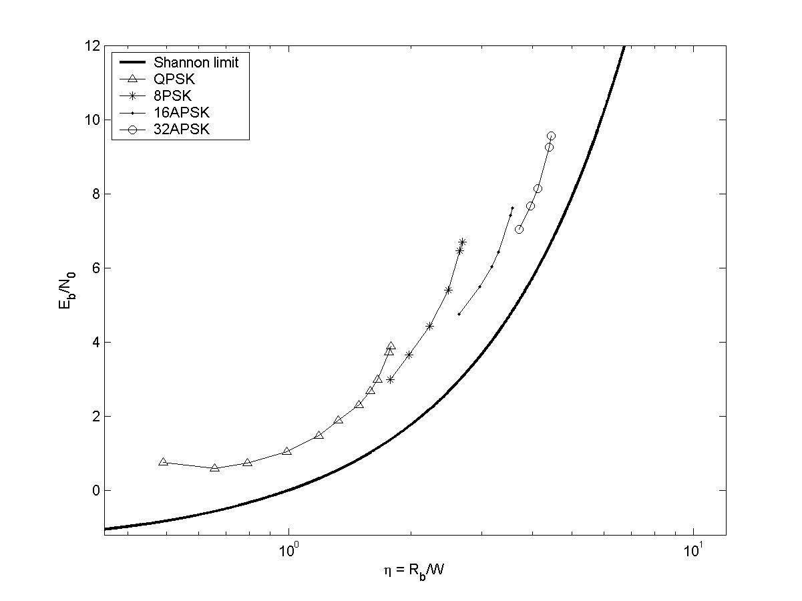

***Figure 3.14:** Performance of DVB-S2 for each modulation format and coding rate at $`\mathrm{PER}=10^{-7}`$ with respect to absolute Shannon limit*

<a id="figure-3.15"></a><a id="f:Perf2"></a>

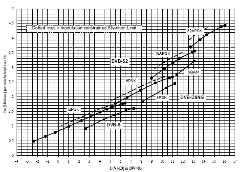

***Figure 3.15:** Performance versus constrained Shannon limits*

<div class="center">

<div>

<a id="table-3.7"></a><a id="tb:EtaPerf"></a>

***Table 3.7:** DVB-S2 performance at $`\,\mathrm{PER}=10^{-7}`$*

| Modulation | Coding rate (LDPC) | Spectral efficiency | Ideal $`E_{\mathrm{s}}/N_{\mathrm{0}}`$ for normal FECFRAME | Ideal $`E_{\mathrm{b}}/ N_{\mathrm{0}}`$ for normal FECFRAME |
|:--:|:---|:---|:---|:---|
| QPSK | 1/4 | 0,490243 | -2,35 | 0,75 |
| QPSK | 1/3 | 0,656448 | -1,24 | 0,59 |
| QPSK | 2/5 | 0,789412 | -0,3 | 0,73 |
| QPSK | 1/2 | 0,988858 | 1 | 1,05 |
| QPSK | 3/5 | 1,188304 | 2,23 | 1,48 |
| QPSK | 2/3 | 1,322253 | 3,1 | 1,89 |
| QPSK | 3/4 | 1,487473 | 4,03 | 2,31 |
| QPSK | 4/5 | 1,587196 | 4,68 | 2,67 |
| QPSK | 5/6 | 1,654663 | 5,18 | 2,99 |
| QPSK | 8/9 | 1,766451 | 6,2 | 3,73 |
| QPSK | 9/10 | 1,788612 | 6,42 | 3,89 |
| 8PSK | 3/5 | 1,779991 | 5,5 | 3,00 |
| 8PSK | 2/3 | 1,980636 | 6,62 | 3,65 |
| 8PSK | 3/4 | 2,228124 | 7,91 | 4,43 |
| 8PSK | 5/6 | 2,478562 | 9,35 | 5,41 |
| 8PSK | 8/9 | 2,646012 | 10,69 | 6,46 |
| 8PSK | 9/10 | 2,679207 | 10,98 | 6,70 |
| 16APSK | 2/3 | 2,637201 | 8,97 | 4,76 |
| 16APSK | 3/4 | 2,966728 | 10,21 | 5,49 |
| 16APSK | 4/5 | 3,165623 | 11,03 | 6,03 |
| 16APSK | 5/6 | 3,300184 | 11,61 | 6,42 |
| 16APSK | 8/9 | 3,523143 | 12,89 | 7,42 |
| 16APSK | 9/10 | 3,567342 | 13,13 | 7,61 |
| 32APSK | 3/4 | 3,703295 | 12,73 | 7,04 |
| 32APSK | 4/5 | 3,951571 | 13,64 | 7,67 |
| 32APSK | 5/6 | 4,11954 | 14,28 | 8,13 |
| 32APSK | 8/9 | 4,397854 | 15,69 | 9,26 |
| 32APSK | 9/10 | 4,453027 | 16,05 | 9,56 |

</div>

</div>

---

[← Applications and Features of Satellite Communications](03-applications-and-features-of-satellite-communications.md) · [Contents](README.md) · [BCH Encoding Algorithms for DVB-S2 Digital Transmissions →](05-bch-encoding-algorithms-for-dvb-s2-digital-transmissions.md)
