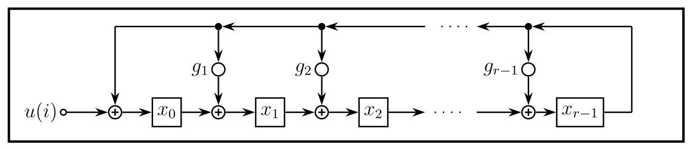
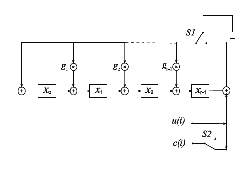

# <a id="ch:BCHAlg&Arch"></a>4 BCH Encoding Algorithms for DVB-S2 Digital Transmissions

## 4.1 Encoding Algorithm Description

As introduced in Section , the systematic encoding of a message
``` math
\begin{equation}
 \mathbf{m} = (m_{k_{\mathrm{BCH}}-1} ,m_{k_{\mathrm{BCH}}-2} ,\ldots  ,m_{1} ,m_{0})
 \tag{4.1}
\end{equation}
```
here expressed in vectorial form, provides a codeword <a id="eq:codsyst"></a>
``` math
\begin{equation}
\mathbf{c} = (m_{k_{\mathrm{BCH}}-1} ,m_{k_{\mathrm{BCH}}-2} ,\ldots  ,m_{1} ,m_{0} ,d_{n_{\mathrm{BCH}}-k_{\mathrm{BCH}}-1} ,\ldots ,d_0)
 \tag{4.2}
\end{equation}
```
composed of $`r=n_{\mathrm{BCH}}-k_{\mathrm{BCH}}`$ redundancy bits, aimed at protecting information messages, in the least significant positions. Codewords in systematic form have in the most significant positions the exact replica of information bits.

According to the cyclic code theory (see Appendix B), the systematic encoding of messages can be carried out through these three steps:

1.  Multiplication of the message polynomial $`m(x)`$ by $`x^r`$. It can be easily realized through a left shift of the information bits by $`r`$ positions and a zero padding of the least significant $`r`$ bits.

2.  Division of this vector by the polynomial generator. Coefficients of the remainder, expressed in polynomial form <a id="eq:remainder"></a>
    ``` math
    \begin{equation}
        d(x) = d_{r-1}x^{r-1} +  d_{r-2}x^{r-2} + \ldots+ d_1 x^1 + d_0
     \tag{4.3}
    \end{equation}
    ```
    represent the $`r`$ parity bits.

3.  Finally, as also stated in Section [A.1](10-galois-or-finite-fields.md#sec:algebraicstruct), <a id="eq:systematic"></a>
    ``` math
    \begin{equation}
     x^{r}m(x)-d(x)
     \tag{4.4}
    \end{equation}
    ```
    provides a codeword. Furthermore, since we are in $`GF(2)`$ and thus $`-d(x) = d(x)`$, the expression [(4.4)](#eq:systematic) can be rewritten as <a id="eq:sistematica"></a>
    ``` math
    \begin{equation}
     x^{r}m(x)+d(x)
     \tag{4.5}
    \end{equation}
    ```

A signal flow diagram of a possible polynomial division implementer is given in Figure [4.1](#fig:PolyDiv). This kind of architecture is usually called Linear Feedback Shift Register because of the feedback wire connecting the last stage with the first stage of the register. We shall show that the LSFR can succeed in computing the remainder (or parity) bits. This linear system provides instant-by-instant quotient and remainder bits together.

It is possible to demonstrate that this LFRS yields at each sampling instant the temporary remainder bits, which in turns have to be updated at the next time instant. Let us give an intuitive proof of this only focusing on the remainder bits (state) evolution of LFSR. Hereafter we will work only with polynomial coefficients in GF(2), even if generalizations in other base fields[^10] are straightforward (e.g. see (F. J. MacWilliams, N. J. Sloane 1977; Stephen B. Wicker 1995; Moon 2005; John G. Proakis 1995)) .

The binary digits in register, after a certain number of computation cycles required (by now it does not matter how many cycles are required), represent the remainder of division. It is useful to observe that taking the remainder after division by $`g(z)=z^4+z^2+1`$ is as imposing $`z^4=z^2+1`$[^11]. This operation is performed by the feedback and taps (i.e. those represented as $`g_1,g_{r-1}`$ in Figure [4.1](#fig:PolyDiv)) of the LFSR.

Since degree of $`g(z)`$ is 4, the shift register length must be 4 (the remainder of division is a polynomial of degree $`r=3`$, which thus have 4 coefficients) as well as the second taps (i.e. $`g_2`$) must be enabled. If the message, from MSB to LSB, $`m(z)=z^8+z^4`$ enters the first sum (modulo 2) node, we have a delay line between entering bit and bit in $`x_3`$ equals to 4. This means that by the feedback wire and taps enabling/disabling all the polynomial coefficients are relatively summed with those of the same degree. When, for example, a $`z^8`$ generates the partial result $`r(z)=(1+z^2)`$ corresponding to $`z^4(1+z^2)`$ at the fifth time instant, the entering coefficient is relevant to degree 4 and then must be summed with the one carried by the feedback wire in order to update $`x_0`$.

Using the equivalent polynomial notation, let us describe the temporal sequence of all the operations performed.

1.  All the register flip flops are set to 0. Coefficient of $`z^8`$ enter $`x_0`$, so determining $`\mathbf{x} =  (1,0,1,0)`$. We can represent the polynomial division together with digits in the flip flops by the following expression
    ``` math
    (r_{1}(z)=1+0\cdot z^1+0\cdot z^2+0\cdot z^3)\cdot z^8
    ```
    where $`r_{i}(z)`$ represent the partial remainder at $`i`$-th iteration.

2.  
    ``` math
    (r_{2}(z)=0+1\cdot z^1+0\cdot z^2+0\cdot z^3)\cdot z^7 + (m_2(z) = 0\cdot z^7)
    ```

3.  
    ``` math
    (r_{3}(z)=0+0\cdot z^1+1\cdot z^2+0\cdot z^3)\cdot z^6 + (m_3(z) = 0\cdot z^6)
    ```

4.  
    ``` math
    (r_{4}(z)=0+0\cdot z^1+0\cdot z^2+1\cdot z^3)\cdot z^5 + (m_4(z) = 0\cdot z^5)
    ```

5.  Here we have $`(r_{5}(z)=1+0\cdot z^1+1\cdot z^2+0\cdot z^3)\cdot z^4 + (m_5(z) = 1\cdot z^4)`$ and then
    ``` math
    (r_{5}(z)=0+0\cdot z^1+1\cdot z^2+0\cdot z^3)\cdot z^4
    ```

6.  
    ``` math
    (r_{6}(z)=0+0\cdot z^1+0\cdot z^2+1\cdot z^3)\cdot z^3 + (m_6(z) = 0\cdot z^3)
    ```

7.  
    ``` math
    (r_{7}(z)=1+0\cdot z^1+1\cdot z^2+0\cdot z^3)\cdot z^2+ (m_7(z) = 0\cdot z^2)
    ```

8.  
    ``` math
    (r_{8}(z)=0+1\cdot z^1+0\cdot z^2+1\cdot z^3)\cdot z^1+ (m_8(z) = 0\cdot z^1)
    ```

9.  
    ``` math
    (r_{9}(z)=1+0\cdot z^1+0\cdot z^2+0\cdot z^3)\cdot z^0+ (m_9(z) = 0\cdot z^0)
    ```
    $`r(z)=r_9(z)`$ corresponding to $`\mathbf{x}=(1,0,0,0)`$ is also the result of division by $`g(z)`$.

The key observation to be made in order to understand the encoding process is interpreting each delay tier as the degree of a polynomial (like $`z`$-transform).

For the architecture in Figure [4.2](#fig:SerEnc), analogous observations upon delay tier between input and output can be made. Here the entering coefficients are summed with the maximum degree coefficients of the partial remainder $`r_{i}(z)`$ at each clock cycle, and thus the delay tier is exactly 0. If the result of this sum is 1 then the feedback is enabled, else it does not. As we shall show in the next section, the choice of feeding the shift register by the right-hand side allows us to achieve better performance.

## <a id="sec:SArch"></a>4.2 Serial Architectures

A problem not yet dealt with is how (and when) the parity bits, once computed, can be extracted from the register. As shown in the previous section, LFSR in Figure [4.1](#fig:PolyDiv) gives the parity bits as all the bits of message-zero-padded, $`m(x)x^r`$, enter the fist sum (modulo 2) node. Therefore, provided that the remainder after division can be fetched and stored in a single clock tick, this LFSR takes $`n_{\mathrm{BCH}}`$ clock cycles to yield the wanted result.

It is interesting to notice that only at a certain discrete time instant (they furthermore fall periodically) the registers of LFSR contain redundancy bits representing the remainder after division. This drawback prevents this type of architecture from working serially because results of division algorithm have to be properly fetched and stored in any other register when the parity bits are ready.

As just noticed, architecture in Figure [4.1](#fig:PolyDiv) is slightly unsuitable for a serial systematic encoder since results of divisions (redundancy bits) have to be read in parallel at every $`(j+1) n_{\mathrm{BCH}}`$ instant for $`j= 0 ,1 ,2 \ldots`$. This can be technically performed, but however the architecture would not be serial anymore. Nevertheless, these facts will become quite interesting in parallelization of the architecture.

On the other hand, a mere serial hardware architecture is illustrated in Figure [4.2](#fig:SerEnc). Differently from above, here the encoder is fed by the opposite side, thus immediately enabling the feedback, allowing the structure so devised to yield the remainder at every $`(j+1) k_{\mathrm{BCH}}`$ instead of $`(j+1) n_{\mathrm{BCH}}`$ for $`j= 0 ,1 ,2 \ldots`$. This permits to read serially parity bits and, besides, set (each register is reset) the device so as to make it ready to encode properly next incoming bit streams. Serial encoding in systematic form is accomplished (see Figure [4.2](#fig:SerEnc)) by:

 Systematic Bits Transmission and Parity Computation  
For clock cycles 1 to $`k_{\mathrm{BCH}}`$, the information bits are transmitted in the natural order (switch S2 in position 2), while also feeding the shift register, to allow parity bits to be calculated in the Linear Feedback Shift Register (LFSR) (to that purpose, switch S1 must be on, activating the feedback mode).

Parity Bits Transmission  
For clock cycles $`k_{\mathrm{BCH}}+1`$ to $`n_{\mathrm{BCH}}`$, the parity bits in the LFSR are transmitted (switch S2 in position 1) and the LFSR feedback mode is switched off (by setting S1 off).

From the above timing consideration, it follows that the latter architecture, spending $`k_{\mathrm{BCH}}`$ clock cycles against $`n_{\mathrm{BCH}}`$, performs more efficiently encoding in case of parallel fetching of the parity bits, as we shall see later on.

<a id="fig:PolyDiv"></a>



***Figure 4.1:** Linear Feedback Shift Register architecture implementing the polynomial division in $`n_{\mathrm{BCH}}`$ clock cycles*

<a id="fig:SerEnc"></a>



***Figure 4.2:** Serial encoder architecture based on LFSR (systematic encoding): it implements the systematic encoding of any codeword in $`n_{\mathrm{bch}}`$ clock ticks. At the end of each message encoding, encoder does not require a reset of the state register and thus is ready to immediately encode a new incoming message.*

## 4.3 Encoding Algorithms for Parallel Architectures

### <a id="s:model"></a>4.3.1 Modelling System

From the theory of control we know that any linear system, fed by an input signal $`\mathbf{u}(i)`$ can be described by the following system of linear equation <a id="eq:LinSys"></a><a id="subeq:GeneralOutput"></a><a id="subeq:GeneralState"></a>
``` math
\begin{align}
\mathbf{y}(i) & = \mathbf{Cx}(i) + \mathbf{Du}(i)  \tag{4.6a}\\
\mathbf{x}(i+1) &= \mathbf{Ax}(i) + \mathbf{Bu}(i)
 \tag{4.6b}\end{align}
```
where [(4.6a)](#subeq:GeneralOutput) expresses its outcomes $`\mathbf{y}(i)`$ at each sampling (discrete) instant, while [(4.6b)](#subeq:GeneralState) describes its trajectory of state $`\mathbf{x}(i)`$, i.e., the state evolution of the linear system in question. Without descending in further details, we shall particularize both equations for the linear feedback shift register shown in Figure [4.1](#fig:PolyDiv) and, starting from them, find equations relevant to an architecture with a $`p`$ degree of parallelism. We shall notice that they will perfectly match with system [(4.6)](#eq:LinSys).

The Linear Feedback Shift Register (LFSR) depicted in Figure [4.1](#fig:PolyDiv) is a linear system, and thus can be described by the well known output equation expressing $`y(i)`$, the scalar output, and the state transition equation expressing the vector state $`\mathbf{x}(i)`$ as a function of the discrete time $`i`$ <a id="eq:LFSR"></a><a id="eq:statequation"></a>
``` math
\begin{align}
 y(i) & = \mathbf{cx}(i) + d\cdot u(i)  \tag{4.7a}\\
\mathbf{x}(i+1) &= \mathbf{Ax}(i) + \mathbf{b}u(i)
 \tag{4.7b}\end{align}
```

In particular, for the desired parallel BCH encoding procedure, we are only interested in the (state) vector
``` math
\begin{equation}
\mathbf{x}(i) =
\left(
\begin{array}{ccccc}
  x_0(i)   & x_1(i) & \ldots  & \ldots & x_{r-1}(i) \\
\end{array}
\right)^{\mathrm{T}}
 \tag{4.8}
\end{equation}
```
and in its temporal evolution/transition because $`\mathbf{x}(i)`$ represents the parity bits after the required number of computation cycles. Thus, hereafter we shall focus only on [(4.7b)](#eq:statequation). The scalar $`u(i)`$ indicates the input at the sampling instant $`i`$, as put in evidence in Figure [4.1](#fig:PolyDiv) and Figure [4.2](#fig:SerEnc). The matrix $`\mathbf{A}`$ models the state evolution of the system in absence of external stimulus (i.e., $`u(i)=0`$), and thus is usually called the state transition matrix. For analogous reasons, the column vector $`\mathbf{b}`$ is called as the input-to-state transfer relationship.

The form of $`\mathbf{A} ,\mathbf{b}`$ depends uniquely on the position of taps and connections in the LFSR. In other words, that form is strongly dependent on the selected architecture implementing the encoding algorithm. More precisely, the matrix $`\mathbf{A}`$ depends on the taps collocations of LSFR, whereas vector $`\mathbf{b}`$ depends on where the input/s is/are connected to the system.

Now, referring to the LFSR architecture depicted in Figure [4.1](#fig:PolyDiv), which can yield the redundancy bits after $`n_{\mathrm{BCH}}`$ clock cycles, we can write, on the one hand, <a id="eq:ParSyst"></a>
``` math
\begin{align}
\mathbf{A} & = \left (
\begin{array} {ccccc}
0      &  0     & \ldots &  0     & g_0\\
1      &  0     & \ldots & 0      & g_1\\
\vdots &  1     & \ldots &   0    & g_2\\
       & \vdots & \ldots & \vdots & \vdots\\
0      & 0      & \ldots & 1      & g_{r-1} \\
\end{array} \right ) &
\mathbf{b} & = \left(
\begin{array}{c}
  1 \\
  0 \\
   \vdots \\
    \vdots \\
    0\\
\end{array} \right)
 \tag{4.9}\end{align}
```
where $`\mathbf{A}`$, $`r`$ by $`r`$ state transition square matrix, contains in the last column the polynomial generator coefficient except for its coefficient of maximum degree. On the other hand, column vector $`\mathbf{b}`$ of length $`r`$ gives a mathematical representation of the physical input-to-system connections.

As introduced in Section [4.2](#sec:SArch), the adoption of the architecture in Figure [4.2](#fig:SerEnc) permits to save some clock ticks. Not surprisingly, only $`\mathbf{b}`$ has changed its form whereas the representation of matrix $`\mathbf{A}`$ given in [(4.9)](#eq:ParSyst) still holds. Since inputs enter now from the right-hand side, we have the new column vector <a id="eq:vetb"></a>
``` math
\begin{equation}
\mathbf{b} =
\left(
\begin{array}{c}
  g_0 \\
  g_1 \\
   \vdots \\
    \vdots \\
    g_{r-1}\\
\end{array}
\right)
 \tag{4.10}
\end{equation}
```
which models – as before – the input incidence on the system state.

### 4.3.2 Parallel Linear System Description

In the previous section we have briefly described a possible model of system which can be easily exploited in parallelizing a general serial architecture with a degree of parallelism $`p`$. Starting from [(4.7b)](#eq:statequation) and applying instant-by-instant and recursively the following substitutions
``` math
\begin{align*}
\mathbf{x}(i) &= \mathbf{Ax}(i-1) + \mathbf{b}u(i-1)\\
\mathbf{x}(i-1) &= \mathbf{Ax}(i-2) + \mathbf{b}u(i-2)\\
\vdots \\
\mathbf{x}(i-p+1) &= \mathbf{Ax}(i-p) + \mathbf{b}u(i-p)\\
\mathbf{x}(i) &= \mathbf{A} \left[ \mathbf{Ax}(i-2) + \mathbf{b}u(i-2)\right] + \mathbf{b}u(i)\\
&= \mathbf{A}^2 \mathbf{x} (i-2) + \mathbf{Ab} u(i-2) + \mathbf{b} u(k-1)
\end{align*}
```
we can observe that the evolution of this system at a generic sampling instant $`i`$ depends on

- the state vector relevant to a generic former instant;

- a set of former inputs whose cardinality is equal to the difference among the current time index and the former instant selected.

This is equivalent, from an architectural implementation point of view, in feeding the encoding processor by a set of parallel inputs, associating to each of the multiple input wires a different (multiple) time instant. Hence, parallelization is straightforwardly achieved.

Returning to the above expression, the system evolution for a generic degree of parallelism $`p`$ is modelled by the following state equation <a id="eq:pseq"></a>
``` math
\begin{equation}
\mathbf{x}(i) = \mathbf{A}^p(i-p) + \sum_{k=0}^{p-1}{\mathbf{A}^k \mathbf{b} u(i-k-1)}
 \tag{4.11}
\end{equation}
```
Now, setting the column vectors $`\mathbf{A}^k \mathbf{b}`$ as follows <a id="eq:Bmatrix"></a>
``` math
\begin{equation}
\left(
\begin{array}{ccccc}
  \mathbf{b} & \mathbf{Ab} & \ldots & \mathbf{A}^{p-2} \mathbf{b} &  \mathbf{A}^{p-1} \mathbf{b}
\end{array}
\right)
 \tag{4.12}
\end{equation}
```
we can define a new $`r`$ by $`p`$ $`\mathbf{B}_p`$ matrix which represent the incidence of the last $`p`$ inputs <a id="eq:newu"></a>
``` math
\begin{equation}
\mathbf{u}(ip) =
\left(
\begin{array}{ccccc}
  u(ip-1)   & u(ip-2) & \ldots  & \ldots & u \left[ p(i-1))\right] \\
\end{array}
\right)^{\mathrm{T}}
 \tag{4.13}
\end{equation}
```
on the system evolution. Considering both [(4.12)](#eq:Bmatrix) and [(4.13)](#eq:newu), we can therefore rewrite the state equation [(4.11)](#eq:pseq) as <a id="eq:SEmatr"></a>
``` math
\begin{equation}
\mathbf{x} (ip) = \mathbf{A}^p \mathbf{x} \left[ (i-1)p \right] + \mathbf{B}_p \mathbf{u}(ip)
 \tag{4.14}
\end{equation}
```
where the sum $`\sum_{k=0}^{p-1}{\mathbf{A}^k \mathbf{b} u(i-k-1)}`$ has just been replaced by the above matrices product.

### <a id="sec:Regularity"></a>4.3.3 Matrices Structure and Properties

In every practical case, the wanted degree of parallelism is strictly less than the number of registers containing the remainder bits at the end of every bit stream processing. For this reason, in this section we shall describe the main characteristics of matrices $`\mathbf{A}^p`$ and $`\mathbf{B}_p`$ only within the range $`0 < p \le r`$ of our interest.

Therefore for a generic degree $`p`$ (within the above specified range) we have <a id="eq:Apreg"></a>
``` math
\begin{equation}
\mathbf{A}^p =
\left(
\begin{array}{cc}
\mathbf{0} & \mathbf{C}_1 \\
\mathbf{I} & \mathbf{C}_2
\end{array}
\right)
 \tag{4.15}
\end{equation}
```
where

- $`\mathbf{0}`$ represents a null $`p \times p`$ matrix;

- $`\mathbf{I}`$ represent a square $`r-p`$ by $`r-p`$ identity matrix;

- $`\mathbf{C}_1`$ is a $`p \times p`$ matrix where each row represents the combinatorial connections (1 when it is active, 0 otherwise) between last and first $`p`$ bits of vector $`\mathbf{x}(i)`$;

- $`\mathbf{C}_2`$ is a $`(r-p) \times p`$ matrix where each row represents the combinatorial connections between last $`p`$ bits and the remaining bits of the vector $`\mathbf{x}(i)`$

Differently from $`\mathbf{A}^p`$ matrix, $`\mathbf{B}_p`$ as well as $`\mathbf{b}`$ (as just said in Section [4.3.1](#s:model)) is strictly dependent on where inputs are. Referencing to the LFSR architecture depicted in Figure [4.1](#fig:PolyDiv), we have therefore <a id="eq:Btrivial"></a>
``` math
\begin{equation}
\mathbf{B}_p =
\left(
\begin{array}{c}
\mathbf{I} \\
\mathbf{0}
\end{array}
\right)
 \tag{4.16}
\end{equation}
```
in case on which the feedback starts at least (depends on the position of the first one in the message) after $`\frac{r}{p}`$ clock ticks (supposing that $`p`$ is a divisor of $`r`$). Identity matrix has size $`p\times p`$. For example, for a $`\mathrm{BCH(7,15)}`$ with a degree of parallelism $`p=5`$ [^12] we get

<a id="eq:triex"></a>
``` math
\begin{align}
\mathbf{A}^5 & =
\left( \begin{array}{cccccccc}
 0 &  0 &  0 &  1 &  1 &  0 &  1 & 0 \\
 0 &  0 &  0 &  0 &  1 &  1 &  0 & 1 \\
 0 &  0 &  0 &  0 &  0 &  1 &  1 & 0 \\
 0 &  0 &  0 &  0 &  0 &  0 &  1 & 1 \\
 0 &  0 &  0 &  1 &  1 &  0 &  1 & 1 \\
 1 &  0 &  0 &  0 &  1 &  1 &  0 & 1 \\
 0 &  1 &  0 &  1 &  1 &  1 &  0 & 0 \\
 0 &  0 &  1 &  1 &  0 &  1 &  0 & 0 \\
\end{array}\right) &
\mathbf{B}_5 & = \left(
\begin{array}{ccccc}
 1 &  0 &  0 &  0 & 0 \\
 0 &  1 &  0 &  0 & 0 \\
 0 &  0 &  1 &  0 & 0 \\
 0 &  0 &  0 &  1 & 0 \\
 0 &  0 &  0 &  0 & 1 \\
 0 &  0 &  0 &  0 & 0 \\
 0 &  0 &  0 &  0 & 0 \\
 0 &  0 &  0 &  0 & 0 \\
\end{array}
\right)
 \tag{4.17}\end{align}
```

As just shown, the structure of above matrix $`\mathbf{B}_5`$ is quite trivial. This result is a direct consequence of the way by which we have defined $`\mathbf{B}_p`$ in [(4.12)](#eq:Bmatrix). Because of simple nature of vector $`\mathbf{b}`$ (which has only a one on the first row), the products between it and increasing powers of $`\mathbf{A}`$ can be obtained by selecting the first column of the first $`p`$ powers $`\mathbf{A}^0= \mathbf{I} ,\mathbf{A}^1 ,\mathbf{A}^2 ,\ldots \mathbf{A}^{p-1}`$ of state matrix. In other words, $`\mathbf{B}_p`$ can be conveniently expressed as <a id="eq:Bp2"></a>
``` math
\begin{equation}
\left[
\begin{array}{ccccc}
  \mathbf{I}(1:,1) & \mathbf{A}(1:,1) & \ldots & {\mathbf{A}}^{p-2}(1:,1) &  \mathbf{A}^{p-1}(1:,1)
\end{array}
\right]
 \tag{4.18}
\end{equation}
```
where a notation as $`\mathbf{X}(1: ,j)`$ indicates the $`j`$-th column of any matrix. In our case we have then to select each first column of matrices in [(4.18)](#eq:Bp2).

The matrix $`\mathbf{B}_p`$ in [(4.17)](#eq:triex) becomes non-structured as the shift register are fed on the opposite side relatively to first and less efficient architecture shown previously (Figure [4.1](#fig:PolyDiv)). In fact, taking into account the new definition [(4.10)](#eq:vetb) of column vector $`\mathbf{b}`$ relevant to the positions of inputs into the system, we get a new $`\mathbf{B}_p`$ matrix which, differently from the previous, does not show any property of regularity. In other words, this new matrix has no longer the trivial form shown in [(4.17)](#eq:triex).

## 4.4 Some Considerations

From an hardware point of view, following considerations can be made:

1.  since codeword length compliant with DVB-S2 standard is long (either short or long FECFRAME), a serial encoder (e.g., that depicted in Figure [4.2](#fig:SerEnc)) may be rather inefficient and slow;

2.  parallel architectures are more flexible solutions when different $`t`$-error correction BCH codes are needed. Since the standard provides different $`t`$ (for BCH) that can be switched on a frame basis, encoder is required to be versatile;

3.  the overall architecture (inner LDPC encoder in parallel implementation) has to be taken into account and a parallel encoder make the interface design simpler.

On the contrary, serial architectures, being based on an elementary LSFR sub-structure, are rather simpler than their parallel version. But, for the reasons enumerated above, they have not been taken in consideration to design the encoding section of DVB-S2.

---

[← DVB-S2 MODEM Concepts and Architecture](04-dvb-s2-modem-concepts-and-architecture.md) · [Contents](README.md) · [Hardware Implementation of BCH Encoder →](06-hardware-implementation-of-bch-encoder.md)
