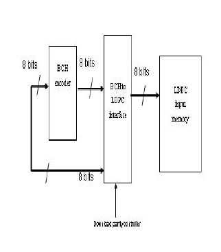
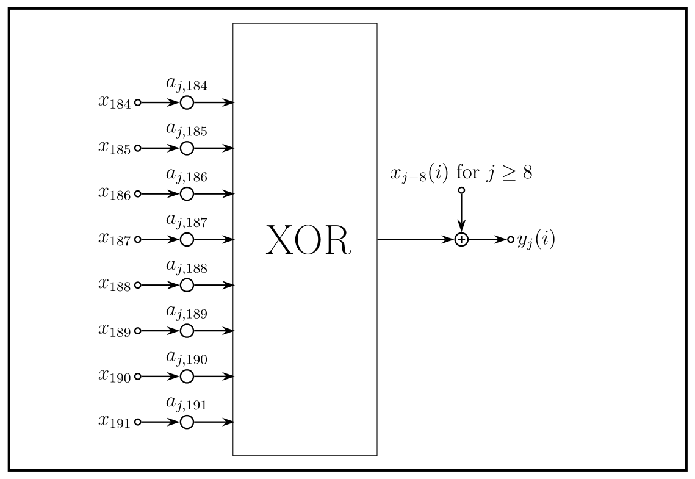
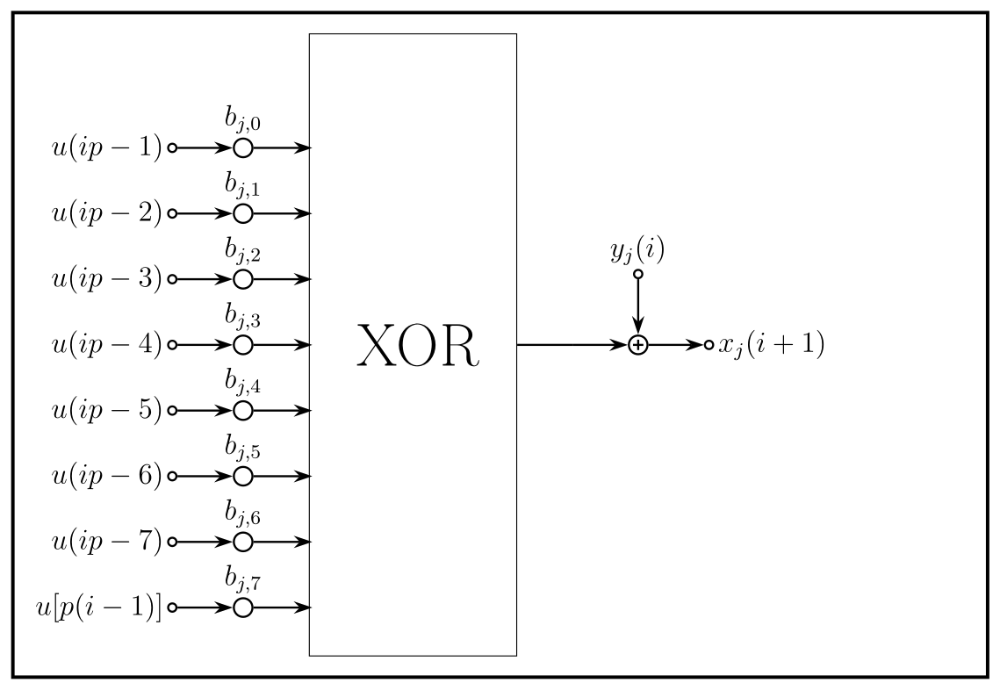
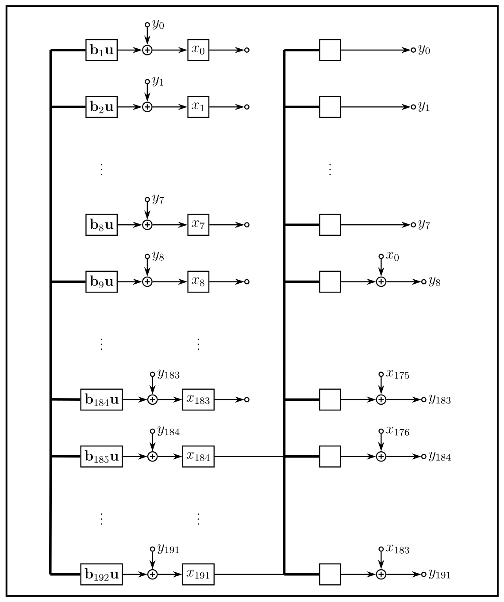
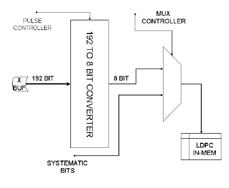
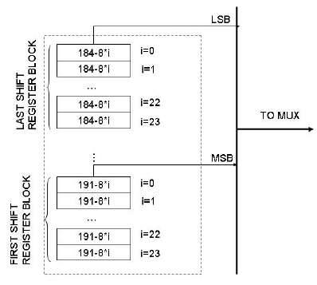

# <a id="chapter-5"></a><a id="ch:BCHencImpl"></a>5 Hardware Implementation of BCH Encoder

## <a id="section-5.1"></a>5.1 FEC Encoding Section

The parallelism of the input memory of the LDPC encoding section suggests a $`p = 8`$ degree of parallelism for BCH architecture. First, because LDPC input memory requires 360 bits and LDPC encoder processes the same number of bits at every clock tick (i.e., it has 360 as degree of parallelism). Hence, $`p`$ should be a divisor of 360. Second, $`p`$ should also be a divisor of each BCH block length ($`n_{\mathrm{bch}}`$) associated with the LDPC coding rates provided by DVB-S2. Furthermore, BCH serial architectures based on LFSRs are, of course, simple to implement, but generally they are very slow (i.e., they typically reach a lower throughput). Therefore, in order to best match BCH encoding speed with the frequency requirements imposed by the overall designed TX DVB-S2 section, we have chosen a degree of parallelism equal to 8.

Encoded bits, passing through an interface circuit, enter the LDPC input memory on a byte basis. The interface allows each codeword coming from BCH encoder to be read in the proper order and format (recall that a systematic code is required as output). A block diagram of the overall FEC section is depicted in Figure [5.1](#fig:ovrsys).

<a id="figure-5.1"></a><a id="fig:ovrsys"></a>



***Figure 5.1:** Block diagram of the overall FEC tx section*

As we shall detail in the next section, the interface between BCH and LDPC is constituted by a simple 8-bit multiplexer together with suitable circuitry to store and download the parity bits after each computation cycle. This interface properly addresses encoded bits into LDPC input memory and it must be driven by a control logic based on the clock cycles required (see Table [5.1](#tb:clkreq)) to provide a codeword.

Another important question to raise is certainly that of giving the architecture a flexible structure so as to succeed in dealing with each coding rate provided by DVB-S2 FEC. Greater versatility, as we shall see, requires additional memory usage: as a matter of fact, some additional coefficients of the matrices mentioned in the previous chapter must be stored into some LUTs (Look Up Tables).

<div>

<a id="table-5.1"></a><a id="tb:clkreq"></a>

***Table 5.1:** Clock cycles required to provide each codeword for each operating mode of DVB-S2*

| BCH Uncoded Block | BCH Coded Block $`N_{\mathrm{BCH}}`$ | Ticks to transmit informative bits | Parity bits download | Total clock cycles |
|:---|:---|:---|:---|:---|
| 16008 | 16200 | 2001 | 24 | 2025 |
| 21408 | 21600 | 2676 | 24 | 2700 |
| 25728 | 25920 | 3216 | 24 | 3240 |
| 32208 | 32400 | 4026 | 24 | 4050 |
| 38688 | 38880 | 4836 | 24 | 4860 |
| 43040 | 43200 | 5380 | 20 | 5400 |
| 48408 | 48600 | 6051 | 24 | 6075 |
| 51648 | 51840 | 6456 | 24 | 6480 |
| 53840 | 54000 | 6730 | 20 | 6750 |
| 57472 | 57600 | 7184 | 16 | 7200 |
| 58192 | 58320 | 7274 | 16 | 7290 |

</div>

## <a id="section-5.2"></a>5.2 Encoder Description

A block diagram of BCH encoder architecture is shown in Figure [5.4](#fig:HWarch). A brief description of its functioning is given below.

- All the informative $`k_{\mathrm{bch}}`$ bits enter in parallel ($`p`$ bits, i.e., 8 at once), from MSB to LSB, all 192 combinatorial blocks, which perform the logic function indicated by $`\mathbf{B}_p`$ matrix. In other words, each block carries out a row-by-column product (over $`GF(2)`$) between the $`i`$-th row of $`\mathbf{B}_p`$ and the $`p`$ inputs. Since the operations are in GF(2), sums are implementable by XOR gates, multiplications by AND gates. Figure [5.3](#fig:COMBin) gives a schematic illustration of each combinatorial network processing $`p`$ inputs.

- Each flip-flop labelled by $`x_i`$ represents a single bit of state vector $`\mathbf{x}`$ of the system and after exactly $`\frac{k_{\mathrm{bch}}}{p}`$ clock ticks it contains the result of division algorithm.

- Combinatorial networks toward the BCH-to-LDPC interface (i.e., on the output side) perform the feedback: each XOR gate is fed by the last $`p`$ bits of register state $`\mathbf{x}`$ (from $`x_{184}`$ to $`x_{191}`$) passing through output-combinatorial network described by the two sub-matrices $`\mathbf{C}_1`$ and $`\mathbf{C}_2`$ (see Section [4.3.3](05-bch-encoding-algorithms-for-dvb-s2-digital-transmissions.md#sec:Regularity)). In more detail, expression [(4.15)](05-bch-encoding-algorithms-for-dvb-s2-digital-transmissions.md#eq:Apreg) in Section [4.3.3](05-bch-encoding-algorithms-for-dvb-s2-digital-transmissions.md#sec:Regularity), showing a high regularity of $`\mathbf{A}^p`$, allows one to split the computation of the first term in [(4.14)](05-bch-encoding-algorithms-for-dvb-s2-digital-transmissions.md#eq:SEmatr) (i.e., $`\mathbf{A}^p \mathbf{x} \left[ (i-1)p \right]`$) in two contributions

  1.  row by column products involving last $`p`$ bits of $`\mathbf{x}`$ and therefore last $`p`$ columns of matrix $`\mathbf{A}^p`$. In other words, the combinatorial networks near the BCH-LDPC interface perform the following product <a id="eq-5.1"></a><a id="eq:prodotto"></a>
      ``` math
      \begin{equation}
              \left(
              \begin{array}{c}
              \mathbf{C}_1 \\
              \mathbf{C}_2
              \end{array}
              \right)
              \left(
              \begin{array}{c}
              x_{184}(i) \\
              \vdots \\
              x_{191}(i)
              \end{array}
              \right)
       \tag{5.1}
      \end{equation}
      ```

  2.  row by column product involving (starting from bit $`x_8`$ of vector $`\mathbf{x}`$ which corresponds to row 9 of matrix $`\mathbf{A}^p`$) first $`n-k-p`$ bits of vector $`\mathbf{x}`$ is realized by sum modulo 2 (i.e., XOR gates) nodes on the right of the combinatorial networks. Figure [5.2](#fig:COMBout) gives a schematic representation of this combinatorial networks together with modulo 2 sum nodes.

- Logic functions relevant to sub-matrix $`\mathbf{I}`$ of $`\mathbf{A}^p`$ are implemented by XOR gates at the output of combinatorial networks connected to the last $`p`$ bits of the state vector.

- At the end of each computation cycle, the encoder register must be reset.

Due to the intrinsic simplicity of matrices $`\mathbf{A}^p`$ and $`\mathbf{B}_p`$ (they are composed only of zeroes and ones), the two combinatorial networks can be implemented in a very simple way by programmable XOR gates with eight inputs. In more detail, each coefficient of the above two matrices specifies which wires have to be connected to each combinatorial network (XOR).

=\[draw, minimum height=9cm, text centered, inner sep= 0pt, text width= 4em, minimum width= 3cm\]

<a id="figure-5.2"></a><a id="fig:COMBout"></a>



***Figure 5.2:** Block scheme of the combinatorial networks acting on the last $`p`$ bits of $`\mathbf{x}`$. $`a_{j ,l}`$ is the coefficient at $`j`$-th row and $`l`$-th column of $`\mathbf{A}^8`$ matrix*

<a id="figure-5.3"></a><a id="fig:COMBin"></a>



***Figure 5.3:** Block scheme representing the combinatorial networks acting on the $`p`$ bit of input. $`b_{j ,l}`$ is the coefficient at $`j`$-th row and $`l`$-th column of the $`\mathbf{B}_8`$ matrix*

## <a id="section-5.3"></a>5.3 Dealing with Each Error Protection

The architecture we have shown so far can only address the greater $`t`$ error protection modalities. However, DVB-S2 has been designed to operate in ACM (Adaptive Coding and Modulation) mode, so that a flexible architecture, capable of changing its behavior on a frame basis, would be more desirable.

From our analysis of the two matrices, we have reached the conclusion that they are very regular and, even changing the generator polynomial of the code, this interesting property still holds. The degree of parallelism $`p`$, once set by design, cannot vary. Henceforth all our considerations will be constrained to a specific degree of parallelism, $`p=8`$, even though the method we are going to show is entirely general.

BCH of DVB-S2 provides three protection levels $`t = 8,10 ,12`$ associated to the following different generators <a id="eq-5.2"></a><a id="eq-5.3"></a><a id="eq-5.4"></a><a id="eq:BCHt12"></a><a id="eq:BCHt10"></a><a id="eq:BCHt8"></a>
``` math
\begin{align}
g_{\mathrm{t_{12}}}(x) & = g_1(x)g_2(x)\ldots g_{12}(x) \tag{5.2}\\
g_{\mathrm{t_{10}}}(x) & = g_1(x)g_2(x)\ldots g_{10}(x) \tag{5.3}\\
g_{\mathrm{t_8}}(x) & = g_1(x)g_2(x)\ldots g_{8}(x)
 \tag{5.4}\end{align}
```
where the above polynomials are in Table [3.4](04-dvb-s2-modem-concepts-and-architecture.md#tb:BCHpoly). With the decrease of the degree of the generator polynomial, also the number $`r`$ of redundancy bits decreases and thus the number of FFs illustrated in Figure [5.4](#fig:HWarch) would be oversized. This implies that, $`\mathbf{x}`$ being changed, size of matrices $`\mathbf{A}^8`$ and $`\mathbf{B}_8`$ has to change. In Section [4.3.3](05-bch-encoding-algorithms-for-dvb-s2-digital-transmissions.md#sec:Regularity) we have shown that, for a reasonable level of parallelism, matrix $`\mathbf{A}^p`$ shows some regularity. In practice, its structure shown in [(4.15)](05-bch-encoding-algorithms-for-dvb-s2-digital-transmissions.md#eq:Apreg) does not change from $`t_8`$ to $`t_{12}`$, although its coefficients are, of course, subject to variations. The same consideration can be made for $`\mathbf{B}_p`$ matrix, which however shows no regularity property for this kind of architecture.

Figure [5.3](#fig:COMBin) and Figure [5.2](#fig:COMBout) clearly show that this kind of combinatorial network is programmable by means of their coefficients, determining which wire has to be connected to the 8-inputs XOR gate and which not. Imposing, for example, that all of these coefficients are forced to zero, we would get the result of having inhibited the $`j`$-th combinatorial network. This is exactly what we can do to deal with all the protection levels $`t`$.

In particular, either $`\mathbf{A}^8`$ or $`\mathbf{B}_8`$ can be embedded into their larger matrices of size, respectively, $`192 \times 192`$ and $`192 \times 8`$ in this way:

Medium Protection Level  
($`t=10`$) Matrices $`(\mathbf{A}^8)_{\mathrm{o}}`$ and $`(\mathbf{B}_8)_{\mathrm{o}}`$ oversized (they should be $`160 \times 160`$ and $`160 \times 8`$ respectively) turn out to be as follows <a id="eq-5.5"></a><a id="eq:embedding"></a>
``` math
\begin{align}
    (\mathbf{A}^8)_{\mathrm{o}} &=
    \left(
    \begin{array}{cc}
    \mathbf{0} & \mathbf{0} \\
    \mathbf{0} & (\mathbf{A}^8)_{\mathrm{t_{10}}}
    \end{array}
    \right) &
    (\mathbf{B}_8)_{\mathrm{o}} &=
    \left(
    \begin{array}{c}
    \mathbf{0} \\
    (\mathbf{B}_8)_{\mathrm{t_{10}}}
    \end{array}
    \right)
 \tag{5.5}\end{align}
```
This corresponds to inhibiting the first 32 pairs of combinatorial networks since their coefficients are all null. Thus, all the first 32 FFs (from $`x_0`$ to $`x_{31}`$) of the BCH encoder will contain always zeroes.

Low Protection Level  
($`t=8`$) The oversized matrices are built in the same manner and now the first 64 pairs of combinatorial networks are inhibited since their coefficients are all null.

<a id="figure-5.4"></a><a id="fig:HWarch"></a>



***Figure 5.4:** Architecture oriented to digital hardware implementation. Each combinatorial network on the left-hand side implements a row by column product of $`\mathbf{B}_8 \mathbf{u}`$. Each row of matrix $`\mathbf{B}_8`$ is indicated as $`\mathbf{b}_j`$ with $`0\leq j<192`$. Each combinatorial network on the right-hand side implements a row by column sub-product in [(5.1)](#eq:prodotto). The 8 bit bus on the input side carries message bits to be encoded.*

## <a id="section-5.4"></a>5.4 Interface and Parity Bits Extraction

The interface between BCH and LDPC encoder can be implemented as illustrated in Figure [5.5](#fig:Interface). The parity bits, once computed (at $`n_{\mathrm{bch}}`$ clock tick), can be saved (in a single clock cycle) in a shift register architecture, which has been called in Figure [5.5](#fig:Interface) 192 (or rather, up to 192) to 8 bit converter. In fact, its task is formatting data in the DVB-S2 format. Furthermore, this kind of architecture allows one to write all the parity bits extracted from BCH encoder (in a single clock tick) into LDPC input memory with a degree of parallelism equal to 8[^13].

Further detailing, the converter is composed of 8 shift register blocks with size equal to 24 bits. In a preliminary phase all the parity bits computed by the BCH encoder are stored in these blocks following the labelling indicated in Figure [5.6](#fig:Download) (to succeed in storing these bits, MUXs between each flip flop can be used). Afterward, the converter works as a shift register, thus allowing to download data eight at once, i.e., with a degree of parallelism equal to 8.

To summarize, let us see, in order for each iteration, the operations carried out by this specific interface:

1.  Once the parity bits have been computed, they are stored in another shift register according to the bit-to-bit mapping illustrated in Figure [5.6](#fig:Download). MUXs between a FF and its neighbor allow to store bits all at once (in parallel) as they are switched on wires carrying results of encoding (these wires may be directly connected to the BCH encoder register).

2.  As MUXs are switched on wires interconnecting FFs with one another, all the bits previously stored, shifting along FFs, are carried by some “strategic” wires on the 8 bits bus, which conveys parity bits toward the output multiplexer. Practically, the register is working as a shift register.

3.  The output multiplexer has two input buses connected to: informative bits and redundancy bits. MUX should be driven by a proper control logic on an operating-mode basis.

<a id="figure-5.5"></a><a id="fig:Interface"></a>



***Figure 5.5:** Interface architecture. Parity bits are loaded into the 192 to 8 bits converter.*

<a id="figure-5.6"></a><a id="fig:Download"></a>



***Figure 5.6:** 192 to 8 bits converter architecture. Values into each FF represent the index mapping between the BCH encoder register and the interface register, used to extract and format data.*

## <a id="section-5.5"></a>5.5 Frequency and Memory Requirements

Taking into account LDPC outer encoder frequency requirements and imposing a data rate equal to $`1 \,\mathrm{Gbps}`$, in the worst case, that is, when $`t=8`$ and LDPC code rate is equal to $`9/10`$, we obtain the maximum frequency requirement so as to guarantee this challenging performance: <a id="eq-5.6"></a>
``` math
\begin{equation}
(f_{\mathrm{clk}})_{\mathrm{MAX}}= \frac{frame}{s}\cdot 7290 = 125 \,\mathrm{MHz}
 \tag{5.6}
\end{equation}
```
As for the memory requirement as well, the proposed architecture takes six (two for each level of BCH protection parameter $`t`$) LUTs to store coefficients used by the combinatorial networks. As a matter of fact, storing the $`\mathbf{C}_1`$ and $`\mathbf{C}_2`$ sub-matrices (recall that they represent two sub-blocks, whose aggregated size is $`192 \times 8`$, of the $`\mathbf{A}^8`$ matrix) coefficients as well as matrix $`\mathbf{B}_8`$, whose size is $`192 \times 8`$, coefficients is required. To provide an encoder capable of dealing with each $`t`$-error protection level, those matrices have to be saved in LUTs for each $`t`$. The size of each LUT is equal to $`192 \,\mathrm{Bytes}`$ and thus the BCH encoder, apart from additional memory required by the BCH-LDPC interface and the encoder state register, requires an amount of memory equal to <a id="eq-5.7"></a>
``` math
\begin{equation}
 2\cdot3\cdot192\,\mathrm{B} = 1,125\,\mathrm{KiB}.
 \tag{5.7}
\end{equation}
```

---

[← BCH Encoding Algorithms for DVB-S2 Digital Transmissions](05-bch-encoding-algorithms-for-dvb-s2-digital-transmissions.md) · [Contents](README.md) · [Software Package for VHDL Validation →](07-software-package-for-vhdl-validation.md)
