# 7 Preliminary Laboratory Test of DVB-S2 TX Section

## 7.1 Introduction

This chapter presents the results of preliminary tests performed on the TAS-I developed TX section of DVB-S2 system whose VHDL has been synthesized, for preliminary validation and test before the equipment production, onto the Stratix II DSP development board. The above section, in particular, includes the BCH section, subject of some of the previous chapters.

A brief description of the TX Section and its individual functional blocks depicted in Figure [7.1](#fig:TXSection) is given below.

<a id="fig:TXSection"></a>

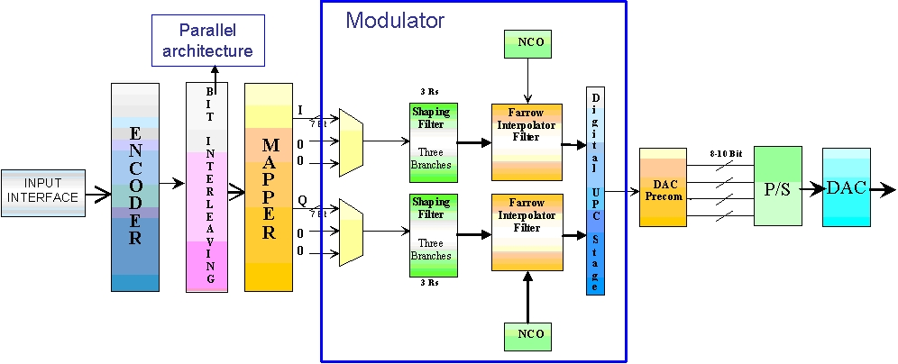

***Figure 7.1:** TX Section Architecture*

Input Interface  
This is the flexible block acquiring the source data: as many packets as required are acquired depending on the output symbol rate, modulation and coding rate of the PLFRAME to be generated.

DVB-S2 Formatter  
As described in chapter [3](04-dvb-s2-modem-concepts-and-architecture.md#ch:DVBS2Arch&Conc), this block composes the frame. The DVB-S2 normal FEC-frame has a fixed length of 64800 bits, excluding pilot bits insertion.

Base Band Header Insertion  
This block inserts a fixed length Baseband Header (BBHEADER) of 10 bytes shall be inserted in front of the DATA FIELD, describing its format (the maximum efficiency loss introduced by the BBHEADER is 0,25% for $`n_{\mathrm{ldpc}}=64800`$ and 1% for $`n_{\mathrm{ldpc}}=16200`$, assuming that inner code rate is $`1/2`$. As said in chapter 2, Data field is simply constituted by the information bits; finally, zero-bits shall be appended after this field in order to have a constant length of $`k_{\mathrm{bch}}`$ bits (Padding).

BB Scrambling  
This block is necessary since the complete BBFRAME shall be randomized. The randomization sequence shall be synchronous with the BB­FRAME, starting from the MSB and ending after $`k_{\mathrm{bch}}`$ bits. The randomization is realized by adding the BBFRAME sequence (starting from MSB) to a random sequence generated by a linear shift register and initialized at the beginning of each frame. The scrambling sequence has been stored in a ROM memory; informative bits are processed in parallel by means of a standard parallelization of a linear system.

Physical Layer Scrambling Block  
Prior to modulation, each PLFRAME, excluding the PLHEADER, has to be randomized for energy dispersal by multiplying the $`(I+ \mathrm{j}Q)`$ samples by a complex randomization sequence $`(CI+ \mathrm{j}CQ)`$. The randomization sequence is re-initialized at the end of each PLHEADER, besides the PLFRAME duration depends on the modulation selected, thus the randomization sequence length shall be truncated to the current PLFRAME length. The scrambling code sequences are constructed by combining two real $`m`$-sequences (generated by means of two generator polynomials of degree 18) into a complex sequence. The resulting sequences thus constitute segments of a set of *Gold sequences*. The physical layer scrambling has been generated by a ROM memory which is read starting from the address 0 at the beginning of each frame.

Encoder Block  
This functional block provides the following functions:

- CRC-8 (1-Byte Cyclic Redundancy Check) insertion on the incoming packets;

- outer (BCH) and inner (LDPC) encoding, according to the selected coding rate (see Table [3.5](04-dvb-s2-modem-concepts-and-architecture.md#tb:codpar));

- bit interleaving, when the selected modulation format is an 8PSK.

CRC-8 Encoder  
This functional block is necessary only for packetized streams only.

Bit Interleaving Block  
The direct implementation of the Bit Interleaving suggested by Hughes Network Systems (HNS) in the ETSI standard definition strongly reduces the maximum achievable baud rate; in effect maximum baud rate is $`f_{\mathrm{ck}}/\eta`$, where $`f_{\mathrm{ck}}`$ is the operating frequency and $`\eta`$ is the modulation efficiency.

Later on an alternative parallel architecture is introduced that doesn’t present this limitation.

Our goal has been to carry out a parallel bit interleaving by means of a block that outputs one modulation signal per clock cycle in order to maximize the achievable baud rate. In this case, if $`f_{\mathrm{ck}}`$ \[MHz\] is the operating frequency, we will have a maximum achievable baud rate equal to $`f_{\mathrm{ck}}`$ \[MBaud\].

The goal is obtained by means of a parallel architecture, which allows to read $`\eta`$ consecutive bits per clock cycle belonging to different symbols; in this way, we provide one symbol per clock cycle.

Mapper Block  
Mapping into constellation is carried out according to the selected modulation format (Q-PSK or 8-PSK); constellations are stored in a ROM (Read Only Memory) and a 7-bit representation has been used for $`I`$ and $`Q`$ components.

Shaping Filter  
The $`I`$ and $`Q`$ data paths at the output of the serial to parallel block are processed by the SRRC (Squared Root Raised Cosine) filter and polyphase interpolator included on the same structure.

This filter is used to provide the interpolation and pulse shaping of the data in order to minimize intersymbol interference. The complex valued coded symbols stream is applied at the input of this sub-unit which performs SRRC pulse shaping by a FIR filter running at rate $`3 R_{\mathrm{s}}`$ . The choice of a processing rate equal to $`3 R_{\mathrm{s}}`$ is made considering that the desired sampling frequency $`f_{\mathrm{SA}}`$ is achieved by interpolating the shaped signal; as a consequence an adequate attenuation of the signal spectrum replica, centered around the interpolator input sampling frequency, is required.

Interpolator Section  
In this specific case a third order Farrow Interpolator block has been used to change the rate at the output of the polyphase filter, depending on the input bit rate selected.

Digital Up Conversion (UPC) Stage  
This block realizes the up-conversion from the baseband frequency to the intermediate frequency.

DAC Precompensation Filter  
This block has been designed to compensate the signal distortion (about $`4\,\mathrm{dB}`$ from DC to half the sampling frequency) introduced by the D/A conversion; in order to correct this linear distortion a FIR filter is used, just before the DAC.

This is most for a number of reasons, e.g. the need for complex filter coefficients in case compensation were done at base-band; however, high speed operations are actually desirable: hence, a coefficient simplification is introduced to avoid multiplications and the transpose form of a FIR filter has been used; pipelining can also be used for it to further enhance speed if required.

## 7.2 Test Objectives and Setup

Aim of this test campaign is to verify the encoder and modulator design and its performances in terms of constellation implementation quality: this is pursued via a statistical characterization on phase and magnitude error.

All tests have been performed after synthesizing the VHDL-based design onto a Stratix II DSP Development Board, which includes an EP2S180 device. Additionally, this board provides two 14-bit D/A converters with an up to 165-Megasample per second rate and single-ended output.

In order to best evaluate the modulator performances, signal at the output of D/A converter has been routed to an ultra-broadband Vector Signal Analyzer (VSA) which also executes demodulation. The VSA is composed by the association of:

1.  a MSO6054A 6000 series oscilloscope ($`500\,\mathrm{MHz}`$ bandwidth, $`4\,\mathrm{Gsa/s}`$);

2.  the 89601A vector signal analyzer software, running onto a PC interconnected to the oscilloscope via an Ethernet port.

Test setup equipments is shown in Figure [7.2](#fig:TestEqu), Stratix II FPGA hosts the VHDL-based design.

<a id="fig:TestEqu"></a>

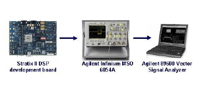

***Figure 7.2:** Laboratory Test*

In particular, sampling rate and IF center frequency have been designed in order to meet the requirements in presence of the HW constraints imposed by both the prototyping board and the anti-image filters available. A parallel to serial converter at the output of modulator has been added to serialize the four parallel data streams at the output of Tx section. Note that the four parallel flows are normally necessary to relax the high speed as well as the relevant criticality in the transfer of data from the TX DSP section to the DAC. The overall transmitter schematic diagram is shown in figure above.

Tx section performances have been evaluated in terms of constellation quality, furthermore, a statistical analysis of magnitude and phase errors has been computed exploiting the dedicated tool available in VSA.

The tool is based on the EVM (Error Vector Magnitude) analysis. EVM is the Root Mean Square (RMS) of the error vectors computed and expressed as a percentage of the square root of the mean power of the ideal signal. The instrument, apart from peak values, can also provide the statistically estimated standard deviation of the EVM and of the phase error.

The error vector is the magnitude of the vector, at the detected symbol location, which connects the I/Q reference-signal phasor to the I/Q measured-signal phasor, and is computed as follows (for a graphical representation refer to the phasor diagram shown below):
``` math
\begin{equation}
\mathrm{EVM}[n] = \sqrt{{I_{\mathrm{err}}[n]}^2 + {Q_{\mathrm{err}}[n]}^2}
 \tag{7.1}
\end{equation}
```
where the variable $`n`$ indicates the discrete symbol time and obviously the error in phase is $`I_{\mathrm{err}} = I_{\mathrm{Ref}}-I_{\mathrm{Meas}}`$, that is, the reference $`I`$ component is subtracted to the measured component. In a similar way the component of error in quadrature can be measured as follow: $`Q_{\mathrm{err}} = Q_{\mathrm{Ref}}-Q_{\mathrm{Meas}}`$.

<a id="fig:EVMAGN"></a>

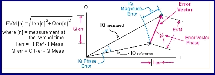

***Figure 7.3:** Error vector magnitude computation*

In addition, magnitude error and phase error (computed as described in Figure [7.4](#fig:MAGNPHASE)) vs time diagram (expressed in symbols) have been plotted to better evaluate constellation quality.

<a id="fig:MAGNPHASE"></a>

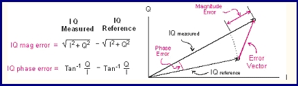

***Figure 7.4:** Magnitude and phase error computation*

## 7.3 Test Results

In this preliminary test campaign, some measurements on the developed DVB-S2 TX section have been performed. For both $`2 \,\mathrm{MBaud}`$ and $`30 \,\mathrm{MBaud}`$ symbol rates, demodulated signal constellations have been plotted.

From a statistical point of view, modulator performance have been evaluated computing phase and magnitude error in the way indicated before.

From results of these preliminary test, degradation due to imperfect image rejection and DAC distortion is clear.

### 7.3.1 2 MBaud — 16 APSK

In this test, signal constellation demodulated by VSA has been visually and qualitatively analyzed. In addition, phase and magnitude error have been plotted and quantified via statistical measurements to better analyze the modulation quality.

<a id="fig:16PSK2MBaud"></a>

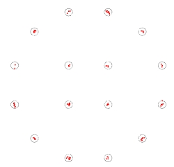

***Figure 7.5:** 2MBaud 16 APSK constellation*

The statistical analysis of errors leads to the following results:

<div class="center">

|                 |       |
|:----------------|:------|
| EVM             | 2%    |
| Magnitude Error | 0,9%  |
| Phase Error     | 3 deg |

</div>

A very limited degradation with respect to the ideal constellation is actually evident.

<a id="fig:SigReplica"></a>

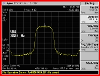 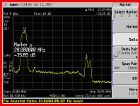

***Figure 7.6:** $`2 \,\mathrm{MBaud}`$ 16-APSK Signal spectra*

### 7.3.2 30 MBaud — 8 PSK

In this test, degradation of modulator performances due to the absence of a DAC pre-compensation filter is clear. In following figures a less scattered plot with pre-compensation filter can be seen.

<a id="fig:8PSK30MBaud"></a><a id="fig:noDAC"></a>

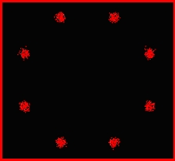 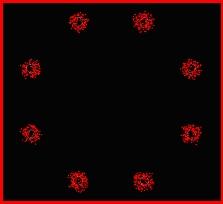

***Figure 7.7:** $`30 \,\mathrm{MBaud}`$ 8-PSK Scatter Plots*

Signal spectra comparison in Figure [7.8](#fig:SpectrComp) shows the distortion introduced by the DAC: the blue curve, as a matter of fact, is the no-precompensated signal spectrum, which results in a very scattered constellation (Figure [7.7b](#fig:noDAC)); the yellow one, representing the signal spectrum of the same signal processed by the precompensation filter, results in a better scatter plot.

<a id="fig:SpectrComp"></a>

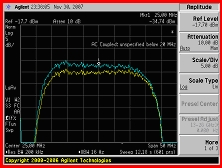

***Figure 7.8:** Spectra comparison between the spectrum of the signal precompensated (yellow one) and that of the signal non-precompensated (blue one)*

The statistical analysis of errors leads to the following results:

<div class="center">

|  | Without pre-compensation filter | With pre-compensation filter |
|:---|:---|:---|
| EVM | 9% | 4% |
| Magnitude Error | 6% | 2% |
| Phase Error | 3 deg | 1,5 deg |

</div>

### 7.3.3 30 MBaud — 16 APSK

In this test, signal constellation demodulated by VSA has been visually and qualitatively analyzed. In addition, phase and magnitude error have been plotted and quantified via statistical measurements to better analyze the modulation quality.

<a id="fig:16APSK30MBaud"></a>

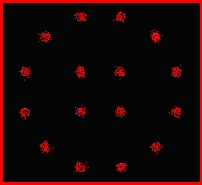 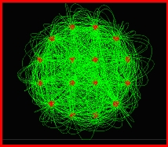

***Figure 7.9:** $`30 \,\mathrm{MBaud}`$ 16-APSK Scatter Plots*

The statistical analysis of errors leads to the following results:

<div class="center">

|                 |       |
|:----------------|:------|
| EVM             | 3%    |
| Magnitude Error | 1,5%  |
| Phase Error     | 2 deg |

</div>

## 7.4 64-APSK Modulator

The modulator tested by TAS can also provide modulations of higher order with respect to DVB-S2 (e.g. MHOMS modulation schemes). Figure shows a progressive expansion of time-scale representation for a 64-APSK modulation scheme, being this the most innovative modulation, and the four signal envelope level either(points lie on 4 concentric circumferences, that is, each radius represents the amplitude of each level provided).

<a id="fig:64APSKwvform"></a>

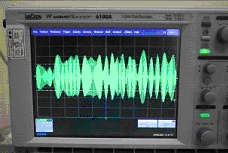 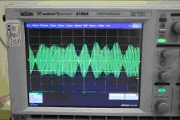 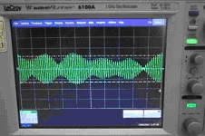 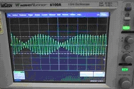

***Figure 7.10:** 64-APSK Signal*

---

[← Software Package for VHDL Validation](07-software-package-for-vhdl-validation.md) · [Contents](README.md) · [Conclusions →](09-conclusions.md)
